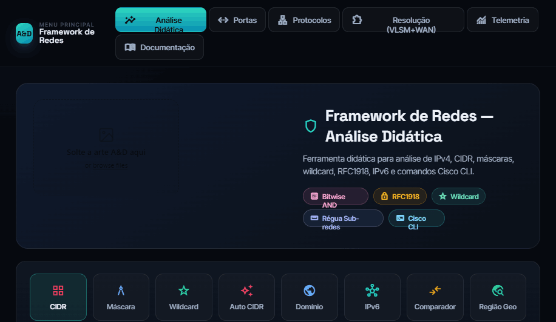
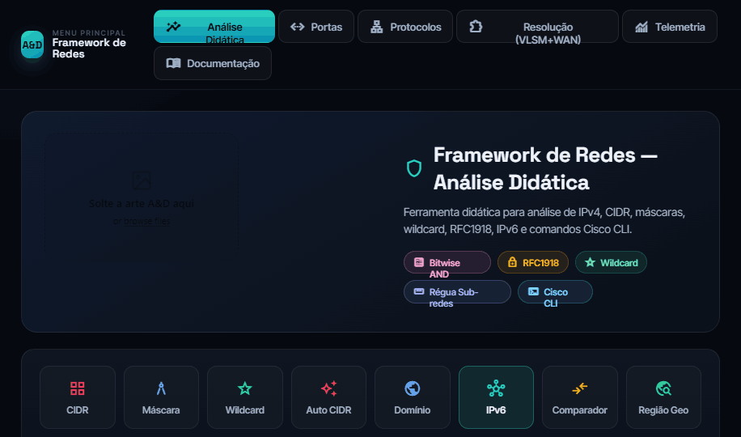
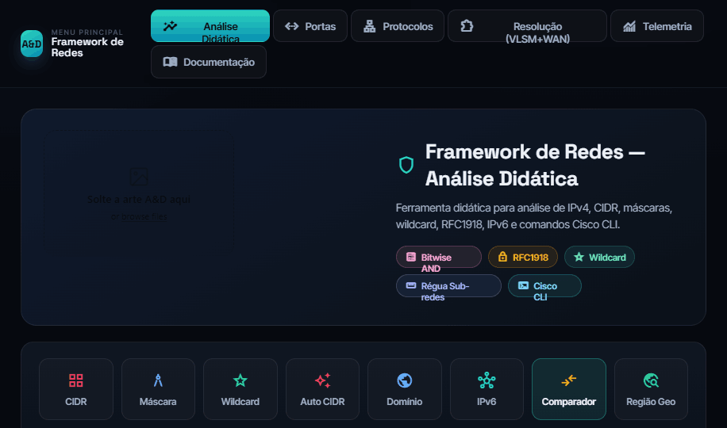
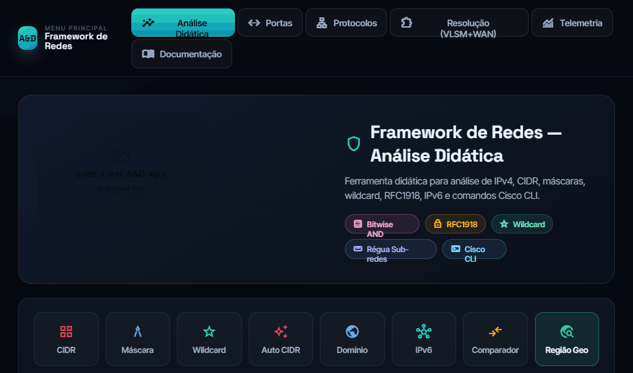
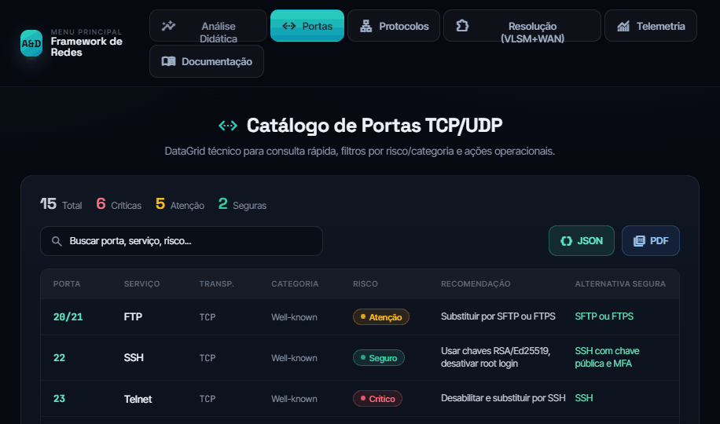
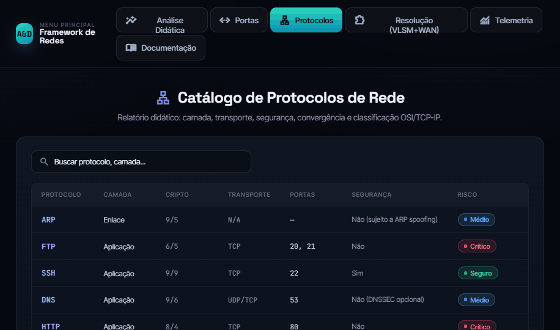
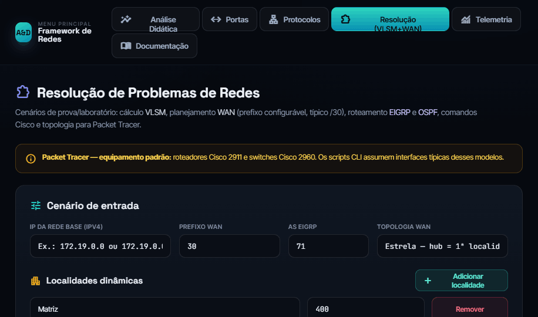
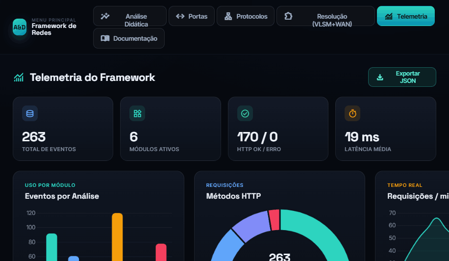
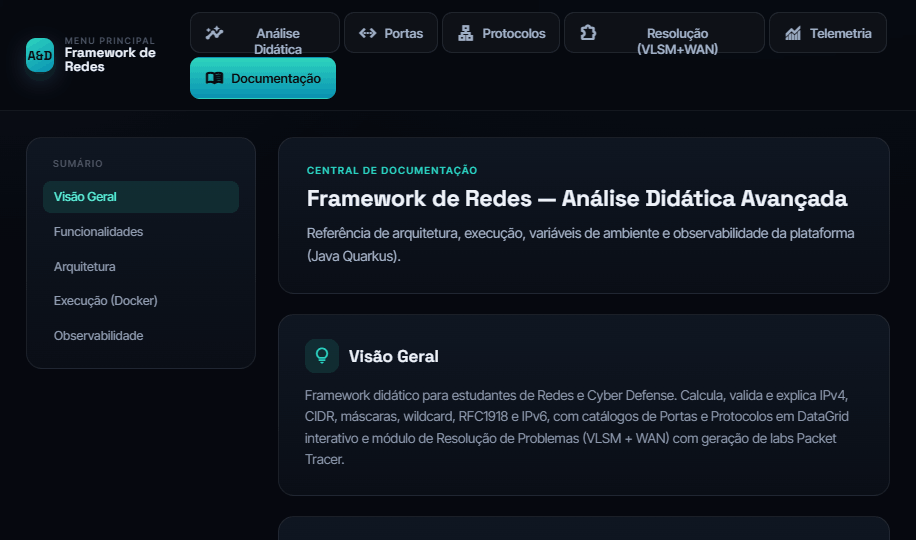

# Framework de Redes — Análise Didática Avançada (Java / Quarkus)

Ferramenta didática de redes migrada de **Python/Flask** para **Java 25 + Quarkus 3.37**, reorganizada como um **monólito modular** (*modular monolith*) — um único artefato de implantação com domínios autocontidos (*bounded contexts*), prontos para evoluir para microserviços.
Cobre análise de IPv4/IPv6, CIDR, máscaras, wildcard, VLSM, topologia WAN, scripts Cisco CLI, catálogos de portas/protocolos, GeoIP e telemetria.

[](https://openjdk.org/)
[](https://quarkus.io/)
[](https://www.docker.com/)
[](./LICENSE)


## Módulos

| Módulo | Rota | Descrição |
|--------|------|-----------|
| Início | `/` | Página inicial (landing) com visão geral e atalhos para os módulos |
| Academia | `/academia` | Escola de redes do básico ao avançado: níveis em abas que desbloqueiam um por vez (Fundamentos, IPv4, Transporte) e lições em **Entenda · Ver · Mexer · Provar**, com as contas no navegador |
| Análise Didática | `/analise` | CIDR, máscara, wildcard, auto-CIDR, domínio, IPv6, comparador |
| Calculadora (IPv4) | `/calculadora` | Sub-redes e VLANs: dividir blocos, plano de VLAN, sumarização e faixa para CIDR |
| Análise Didática IPv6 | `/ipv6/analise` | 128 bits célula-a-célula, tipo IANA, aplicação do prefixo, comparador, domínio (AAAA), Nibbles e Conceitos; export JSON/PDF |
| Calculadora IPv6 | `/ipv6` | Sub-redes (2^n), EUI-64/SLAAC, ULA (fd00::/8), Sumarizar, Faixa → CIDR e **VLANs** (LAN /64 por VLAN + SVI + trunk 802.1Q) |
| Resolução IPv6 | `/ipv6/resolucao` | **Projetar** (delegação de prefixo, WAN /127, CLI OSPFv3/EIGRP e diagrama) e **Engenharia Reversa** (config Cisco → interfaces/rotas) |
| Localização | `/localizacao` | **GeoIP por IP** (região/ISP/risco, movido da Análise Didática) + **CEP** (ViaCEP) em mapa OpenStreetMap |
| Laboratórios | `/laboratorios` | Laboratórios interativos passo a passo: `/laboratorios/camadas` e `/laboratorios/aneis-e-rede` |
| Certificados | `/certificados` | Certificados digitais X.509 / PKI: formatos, campos, tipos e aprofundamentos |
| Camadas | `/camadas` | Modelo OSI × TCP/IP: PDUs, dispositivos e encapsulamento |
| Criptografia | `/criptografia` | Algoritmos, forças, hash, assinatura e playground (WebCrypto) |
| Wi-Fi | `/wifi` | 802.11: padrões, canais, segurança (WPA) e planejador de canais |
| Ferramentas | `/ferramentas` | Ferramentas de rede (CLI): catálogo, aprofundamentos e construtor de comando (`/ferramentas/rede`) |
| Diagnóstico | `/diagnostico` | Simulador de ferramentas de diagnóstico (ping, traceroute, DNS) — didático, sem rede real |
| Segurança | `/seguranca` | Testador de regras de Firewall/ACL, firewall com/sem estado, handshake TLS e alcançabilidade |
| Tráfego | `/trafego` | Dashboard de tráfego **ao vivo** (gráficos estilo Wireshark + Wi-Fi/Bluetooth, modo demo) e decodificador didático de pacotes (hex dump → Ethernet/IP/TCP/UDP/ICMP) |
| GeoIP (página) | `/informacoes` | Página autônoma de geolocalização de IP (MaxMind + fallback) |
| Portas | `/portas` | Catálogo interativo TCP/UDP |
| Protocolos | `/protocolos` | Catálogo + troubleshooting de roteamento (aba **Geral**) |
| Protocolos — BGP | `/protocolos/bgp` | Aprofundamento do **BGP-4**: atributos, ordem de seleção de melhor rota, máquina de estados da sessão, route reflector, filtros/`maximum-prefix`/RPKI, lab Cisco e troubleshooting |
| Protocolos — DNS e TLS | `/protocolos/dns`, `/protocolos/tls` | Aprofundamentos no mesmo padrão do BGP/SSH |
| Protocolos — SSH | `/protocolos/ssh` | Aprofundamento do **SSH**: TOFU e `known_hosts`, camadas do SSH-2, métodos de autenticação, chaves, túneis `-L/-R/-D/-J/-A` e hardening do `sshd_config` |
| Resolução VLSM | `/resolucao-problemas` | Aba **Projetar**: cenários VLSM/WAN, demos, exports e **ZIP da turma** |
| Resolução — reversa | `/resolucao-problemas?aba=reversa` | Aba **Engenharia reversa**: cola a configuração Cisco pronta, **acha e corrige os erros com evidência** e reconstrói LANs, enlaces, tabelas e o desenho |
| Páginas de erro | qualquer rota que falhe | Página única servindo **18 códigos** (400…507) no desenho do app, com `trace_id` real, animação Matrix de pacotes e atalhos de volta |
| Telemetria | `/telemetria` | Dashboard de eventos e console ao vivo |
| Documentação | `/documentacao` | README técnico renderizado |
| Sobre | `/sobre` | O projeto, o autor e as tecnologias usadas |
| Administração | `/admin/login` | Autenticação para rotas sensíveis (`/export/*`) |

## 📸 Telas do sistema

| Análise Didática (CIDR) | Análise IPv6 | Comparador de prefixos |
|:---:|:---:|:---:|
|  |  |  |
| **GeoIP / Região Geográfica** | **Catálogo de Portas** | **Catálogo de Protocolos** |
|  |  |  |
| **Resolução VLSM + WAN** | **Telemetria (OTLP/JSON)** | **Documentação** |
|  |  |  |

## Arquitetura

**Monólito modular** em Java 25 + Quarkus: implantação em um único artefato (fast-jar), com o código organizado por **domínios autocontidos**. Cada domínio de negócio (`analiseDidatica`, `calculadora`, `ipv6`, `resolucaoProblemas`, `portas`, `protocolos`, `certificados`, `camadas`, `criptografia`, `wifi`, `ferramentas`, `ferramentasDiagnostico`, `segurancaRede`, `simuladores`, `analiseTrafego`, `localizacao`, `laboratorios`, `paginaErros`) segue camadas `presentation → application → domain → infrastructure` (DDD-lite / hexagonal), e há módulos transversais (`security`, `telemetria`, `web`, `shared`). Endpoints em JAX-RS (`quarkus-rest`) e views em Qute.

Diagramas completos (filtros, VLSM, telemetria, `shared`, exceções e deploy Docker): veja `/documentacao` ou `src/main/resources/README.md`.

```text
org/framework/net/
├── analiseDidatica/     # presentation · application · domain/kernel · infrastructure (dns/geo/historico) · support
├── calculadora/         # sub-redes, VLAN, sumarização, faixa → CIDR (IPv4)
├── ipv6/                # análise, calculadora e resolução IPv6
├── resolucaoProblemas/  # presentation · application (export/importing/normalization/planning/routing) · domain (kernel/model)
├── portas/ · protocolos/ · certificados/ · camadas/ · criptografia/ · wifi/ · ferramentas/
│                        # catálogos + aprofundamentos (modelo ProtocoloAprofundamento compartilhado)
├── ferramentasDiagnostico/ · segurancaRede/ · simuladores/   # simuladores didáticos
├── analiseTrafego/      # presentation · application (decoder/construtor) · domain/model
├── localizacao/         # presentation · application · infrastructure (ViaCEP · Nominatim/OSM)
├── laboratorios/        # laboratórios interativos
├── paginaErros/         # página única para os códigos HTTP de erro
├── security/            # Admin API key · CSRF · rate limit · sensitive APIs
├── telemetria/          # store · dashboard · filter · presentation
├── shared/              # sanitizers · guards · normalizadores de entrada
└── web/                 # home (landing) · documentacao · admin login · ícone · filtros
```

Os **estáticos** seguem a mesma divisão por módulo dos templates Qute: cada página com estilo próprio tem seu CSS na pasta do módulo (`home/css/`, `portas/css/`, `protocolos/css/`, `telemetria/css/`, `resolucaoProblemas/css/`, `documentacao/css/`) — e, quando o módulo tem várias páginas, cada uma leva o CSS dela (`protocolos/bgp/css/bgp.css`, `protocolos/ssh/css/ssh.css`), enquanto o **design system compartilhado** (casca, nav, cards, botões, tokens) fica em `web/css/app.css` + `web/css/aed-command-center.css`, carregado por `shared/base.html`.

## Requisitos

- JDK **25**
- Gradle (wrapper incluído)
- **Docker** — obrigatório: é assim que o projeto roda, local e em produção

## Desenvolvimento

O projeto sobe **sempre por Docker**, com a mesma imagem, o mesmo Redis e o mesmo perfil da produção:

```powershell
.\scripts\subir.ps1              # constrói, sobe, espera o healthcheck e abre o navegador
.\scripts\subir.ps1 -Porta 8090  # outra porta
.\scripts\subir.ps1 -Recriar     # reconstrói do zero (--no-cache)
.\scripts\parar.ps1              # para, preservando os dados
.\scripts\parar.ps1 -Limpar      # para e apaga volumes (pede confirmação)
```

Aplicação em `http://localhost:8081`. Na primeira execução o script gera um `.env` local com `ADMIN_API_KEY` e `CSRF_SECRET` fortes (fora do git) e imprime a chave no final — o compose de dev roda com o perfil `prod`, e nesse perfil a aplicação **recusa iniciar** com segredo de desenvolvimento versionado.

A Telemetria exige login; em dev o GitHub OAuth fica desligado (a OAuth App tem um único callback registrado, o de produção), então use o **acesso de contingência** com a chave que está no `.env` desta máquina.

**Por que não `gradlew quarkusDev`?** Porque ele roda por outro caminho — sem Redis, sem as variáveis do container, com outro perfil — e esconde exatamente os defeitos que só aparecem em produção. Este projeto já pagou duas vezes por isso: a variável do OAuth que não chegava ao container, e a telemetria sem Redis. O script **não** cai para `quarkusDev` quando o Docker está parado; ele avisa e para, de propósito.

Para depuração pontual com hot reload, `.\gradlew.bat quarkusDev` continua existindo — mas sabendo que aquele ambiente **não** é o de produção.

## Testes

```powershell
.\gradlew.bat test
```

Suíte em JUnit 5 + RestAssured, em `src/test/java`.

### Varredura de UI num navegador real

A suíte prova que o servidor responde. Ela **não** prova que a tela apareceu:
texto cortado, botão coberto, contraste ilegível, aba que não troca, expressão
Qute vazando como `{lab_count}`, ícone que virou a palavra `sync_alt` e overflow
horizontal no celular respondem **200** e só o navegador revela.

```powershell
node scripts/inventario.mjs     # 1. extrai a lista do CÓDIGO (não de memória)
node scripts/varredura.mjs      # 2. varre tudo num Chromium real
```

| Comando | Para quê |
|---|---|
| `node scripts/varredura.mjs` | passada completa: páginas, abas, gatilhos, formulários, modais, links e APIs |
| `node scripts/varredura.mjs --so-paginas` | rápida: só carrega cada tela e mede (pula cliques e envios) |
| `node scripts/varredura.mjs --vigiar` | **tempo real**: repete em ciclo e mostra só o que apareceu de **novo** e o que foi **resolvido** |
| `node scripts/varredura.mjs --vigiar --intervalo=30` | mesmo, a cada 30 s |
| `node scripts/varredura.mjs <url> --permitir-remoto` | varre outra base (produção **exige** a flag, escrita à mão) |

Base remota é recusada sem `--permitir-remoto`, e a `ADMIN_API_KEY` do `.env`
local **nunca** é enviada para fora desta máquina: a varredura clica em cada
gatilho e envia cada formulário, e apontar isso para produção sem querer geraria
tráfego real e telemetria poluída.

`inventario.mjs` lê os `@Path` das resources e os templates Qute (resolvendo os
`{#include}`) e grava `scripts/inventario.json` — páginas, variantes `?query`,
APIs, abas, campos, gatilhos, modais e links. A varredura **só percorre essa
lista**: nada é escolhido de memória, e rota que muda estado (logout, limpar
console, sincronizar dataset) ou baixa arquivo fica fora da navegação de
propósito.

Antes de qualquer medição valer, a varredura **injeta um defeito de cada tipo e
exige que o detector o acuse** — mais um décimo detector calibrado ao contrário
(botão morto: a assinatura da tela **não** pode mudar). Detector cego devolve
"nenhum problema" e é indistinguível de sistema sadio; se algum falhar, a
varredura sai com **código 2 — NÃO VERIFICADO**, que não é aprovação.

Saída: `0` nada encontrado no escopo varrido · `1` há achados · `2` não
verificou. O relatório fica em `scripts/relatorio-varredura.txt`, com seções
separadas para **ruído externo** (CDN, Google Fonts, tradutor), **não
comprovado** (o instrumento não consegue decidir) e **pulados com motivo** (o que
deliberadamente não foi coberto — impressão, download, GPS, área de
transferência).

Guardas menores, que continuam valendo: `node scripts/verificar-js.mjs`
(sintaxe dos `.js`), `verificar-csp.mjs` e `verificar-pwa.mjs`.

Desde 22/10/2026:

- **Largura cheia e unidade relativa** — `CssLarguraPorcentagemGuardTest` (roda com
  `gradlew test`) reprova contêiner de página com `max-width` centralizado, `px` fora de
  borda/sombra, `100vw`, espaço entre linhas de grade em `%` e fonte abaixo de `.75rem`.
- **Dicas (tooltip acessível)** — `node scripts/verificar-dicas.mjs [base]` varre todas as
  páginas com a varredura do componente de tooltip e compara com
  `scripts/dicas-linha-base.json`: elemento novo sem dica reprova; quando a dívida descer,
  regrave com `--gravar`.
- **Bibliotecas de terceiros** (Bootstrap, mermaid, Chart.js, Leaflet) são servidas por
  `/web/vendor/`, com os mesmos `integrity` de antes; o `.gitattributes` impede o git de
  trocar as quebras de linha desses arquivos.

## Docker (VPS)

Crie um `.env` persistente na VPS a partir de `.env.example` e gere `ADMIN_API_KEY`/`CSRF_SECRET` apenas uma vez:

```bash
cp .env.example .env
sed -i "s/troque-por-um-valor-gerado-com-openssl-rand-hex-32/$(openssl rand -hex 32)/1" .env
sed -i "s/troque-por-um-valor-gerado-com-openssl-rand-hex-32/$(openssl rand -hex 32)/1" .env
docker compose -f docker-compose.yml up -d --build
docker compose ps
docker compose logs --tail=20 -f
```

Ou use o script de deploy da VPS, que faz `git pull`, cria/reaproveita `.env`, reconstrói a imagem, espera o healthcheck e mostra os logs:

```bash
chmod +x scripts/deploy.sh
scripts/deploy.sh
```

Perfil `prod`: proxy reverso habilitado, dados persistentes em `/deployments/data`.
**Obrigatório** definir `ADMIN_API_KEY` e `CSRF_SECRET` (veja `.env.example`). Esses valores devem ficar no `.env` da VPS; não regenere a cada deploy.

## Configuração

Principais chaves (`application.properties` / `application-prod.properties`), sobrescritíveis por ambiente:

| Chave / Env | Padrão | Descrição |
|-------------|--------|-----------|
| `HTTP_PORT` / `quarkus.http.port` | `8080` | Porta HTTP |
| `ADMIN_API_KEY` | — | Chave admin (obrigatória em prod) |
| `CSRF_SECRET` | — | Segredo CSRF (obrigatório em prod) |
| `GEO_DB_HOST_PATH` | — | Caminho do `GeoLite2-City.mmdb` (opcional) |
| `framework.dns.cache-ttl-seconds` | `180` | TTL do cache DNS |
| `framework.telemetry.max-events` | `5000` | Eventos em buffer da telemetria |
| `framework.security.rate-limit-per-minute` | `120` | Rate limit geral |
| `framework.security.cookie-secure` | `false` (dev) / `true` (prod) | Marca cookies CSRF/admin como `Secure` (HTTPS) |

## Segurança

- Chave administrativa protege o prefixo `/export` (header `X-Admin-Api-Key` ou login em `/admin/login`), com comparação em tempo constante.
- Proteção CSRF (double-submit + HMAC), rate limiting (com limpeza periódica dos buckets) e headers HTTP de segurança (`X-Content-Type-Options`, `X-Frame-Options`, `Referrer-Policy`, `Permissions-Policy`).
- Cookies `HttpOnly` + `SameSite`; marque `framework.security.cookie-secure=true` atrás de HTTPS (padrão no perfil `prod`).

## Indexação e SEO

Quatro peças, e elas **não são intercambiáveis** — cada uma resolve uma coisa:

| peça | onde | o que resolve |
|---|---|---|
| `robots.txt` | `META-INF/resources/robots.txt` (estático) | por onde o robô **não** passa |
| `/sitemap.xml` | `SitemapResource` | o que existe para ser **encontrado** |
| `canonical` + `description` + Open Graph | `shared/base.html` + `SeoPagina` | qual é o **endereço oficial** da página e como ela aparece no resultado |
| `rel="nofollow"` | links para rota fechada | evita que o robô **descubra** o que não deve rastrear |

A lista do que é página pública mora em **um lugar só**: `web/domain/PaginasPublicas`.
Sitemap, canonical e as guardas leem dela. Aprofundamento novo (porta, protocolo,
certificado, camada, criptografia, Wi-Fi, ferramenta) entra sozinho, porque a lista
é montada a partir dos registros de cada módulo — os mesmos que alimentam o sub-menu.

### A armadilha: `noindex` e `Disallow` se anulam

É o erro mais comum, e parece o contrário do que é:

> Rota fechada com `Disallow` **nunca é buscada**, logo a `<meta name="robots"
> content="noindex">` dela **nunca é lida**. As duas juntas não somam — a segunda
> fica inerte.

Por isso, para cada rota, escolher **uma** estratégia:

- **quero fora do índice e o acesso custa caro** (`/informacoes` dispara consulta
  geográfica externa a cada GET; `/export/*` gera PDF sob demanda) → `Disallow`.
  A URL pode acabar listada sem descrição se alguém a linkar de fora; é o preço, e
  o `rel="nofollow"` nos links internos reduz a chance;
- **quero fora do índice e o acesso é barato** → deixar rastrear e usar `noindex`.
  É o caso das telas autônomas `login/index.html` e `paginaErros/erro.html`, que
  têm a meta no próprio `<head>`;
- **nenhuma das duas é controle de acesso.** Quem fecha `/telemetria`, `/admin` e
  `/export` é o login e o `AdminApiKeyFilter`.

### O host é configurado, nunca deduzido

`framework.site.base-url` (perfil `prod`) alimenta **sitemap e canonical**. Não se usa
o `Host` da requisição: canonical seguindo cabeçalho do cliente deixaria um terceiro
apontar a URL oficial deste site para o domínio dele — e há teste para isso
(`SeoBaseUrlHttpTest#hostForjadoNaoMudaOCanonical`). Sem a propriedade, a URL segue a
requisição, que é o certo em desenvolvimento.

### Guardas (reprovam o build)

- `RobotsTxtHttpTest` — cada grupo permissivo fecha a lista inteira; rota `/*/api/`
  nova no código sem entrar no arquivo reprova. O `robots.txt` **não soma grupos**.
- `SitemapHttpTest` — cruza menu × robots × sitemap; toda URL listada responde 200.
- `SeoHttpTest` — canonical absoluto e description própria em toda página pública;
  rota fechada **não** recebe canonical (com controle positivo, para a guarda não
  aprovar por não ter renderizado nada); query string fora do canonical; link para
  rota fechada marcado `nofollow`.
- `SeoBaseUrlHttpTest` — com host canônico configurado, tudo sai em `https://` no
  domínio público, e `Host` forjado não muda nada.

### O que mora no proxy, e não na aplicação

Três coisas não têm como ser resolvidas dentro do Quarkus, porque acontecem **antes** dele ou
**no lugar** dele. Ficam em dois scripts versionados, para não virarem conhecimento oral:

| script | o que liga |
|---|---|
| `scripts/proxy-seo-frameworknet.sh` | **Force SSL** (o `http://` responde 200 em claro) e o **robots.txt próprio** deste domínio, com a linha `Sitemap:` |
| `scripts/proxy-paginas-erro.sh` | **`error_page` 502/503/504** — sem ele, toda queda de container mostra a tela cinza do openresty |

Os dois rodam **na VPS**, fazem backup, validam com `nginx -t` **antes** de recarregar,
restauram sozinhos se o teste reprovar e são idempotentes. Cada um imprime o rollback no fim.

**As páginas de erro do proxy são geradas, não escritas.** `scripts/erro-proxy/{502,503,504}.html`
saem de `PaginaErroProxyGeneratorTest`, a partir do template real do site e do `CatalogoErros`,
com CSS e JS **embutidos** — elas aparecem justamente quando a aplicação está fora, então nada
nelas pode depender dela. Mexeu no visual do site? Rode a suíte, commite, e na VPS
`git pull && bash scripts/proxy-paginas-erro.sh`.

> ⚠️ `proxy_intercept_errors` fica **desligado** de propósito. Ligá-lo faria o Nginx capturar
> também os 400 em JSON das rotas `/api/`, que virariam HTML e quebrariam todo `fetch()` do
> frontend em silêncio. Por isso só entram no `error_page` os códigos que a aplicação **nunca
> chega a responder**: se ela responde, ela está viva.

**Limite conhecido:** URL com par de escape percentual inválido (`/%%%%`) devolve 400 sem corpo.
Nasce no parser HTTP do Vert.x, antes do roteador — um `router.errorHandler(400, …)` foi
tentado e **medido sem efeito nenhum**, então foi descartado em vez de ficar no repositório
fingindo proteger. Atinge robô, scanner e link corrompido, não fluxo de usuário (o navegador
codifica `%` como `%25`, que é caminho válido e cai no 404 com página).
`RespostaNuncaEmBrancoHttpTest` verifica isso a cada build, e falha **nos dois sentidos**: se um
upgrade do Quarkus passar a devolver corpo, ele avisa que o risco acabou.

### Produção: quem responde o `/robots.txt` não é a aplicação

Enquanto existir o `location = /robots.txt` no NPM, **match exato ganha do
`proxy_pass`** e quem responde é o arquivo do proxy, não o do jar. Desde 03/09 a
política é **por host** (`map $host` com lista branca — nunca `try_files /$host.txt`,
porque `$host` vem do cabeçalho `Host`, que o cliente escolhe). O arquivo deste
repositório é a fonte versionada da política e vale em desenvolvimento e em qualquer
outro deploy — as duas cópias precisam ser mantidas em acordo.

O `/sitemap.xml`, esse sim, é servido pela aplicação.

## Telemetria (observabilidade)

O dashboard vive em `/telemetria`. Os artefatos **compartilháveis** seguem o padrão **OpenTelemetry OTLP/JSON** (Logs Data Model): `logs/telemetria_compartilhada.json` (documento `LogsData`), `logs/framework-net-eventos.jsonl` (um `LogRecord` OTLP por linha) e o download em `GET /telemetria/api/exportar`. Detalhes em `src/main/resources/README.md` ou `/documentacao`.

## Exportações — Resolução de Problemas

| Ação | Arquivo |
|------|---------|
| `export` | `config_packet_tracer_consolidado.txt` |
| `export_zip` | `laboratorio_packet_tracer.zip` |
| `export_entrega` | `documentacao_cenario_rede.txt` |
| `export_class_zip` | `pacote_turma_packet_tracer.zip` (`por_aluno/<aluno>/`) |

### Importar turma (Excel)

Cole na página Resolução (TAB entre colunas):

```
Nome | Rede base | Hosts1 | Hosts2
```

## Documentação

A documentação técnica completa fica em `src/main/resources/README.md` e é renderizada na própria aplicação em `/documentacao`.

## Autor

Paulo André Carminati — site pessoal: [carminati.dev.br](https://carminati.dev.br/)

Repositório: [github.com/carmipa/frameworknet](https://github.com/carmipa/frameworknet)

## Licença

MIT.
