# 🛡️ Framework de Redes - Análise Didática Avançada

> **Versão Java/Quarkus** (`framework-net-java-quarkus`) — Java 25 + Quarkus 3.37.
> Migração do projeto original Python/Flask. Esta documentação é renderizada dentro da própria aplicação em `/documentacao`.

<p align="center">
  
</p>

Aplicação didática para análise de redes IPv4/IPv6, com foco em ensino, laboratório e revisão técnica. Originalmente escrita em **Python/Flask**, foi **migrada para Java 25 + Quarkus** e reorganizada como um **monólito modular** (*modular monolith*): um único artefato de implantação com domínios autocontidos, prontos para evoluir para microserviços. Os módulos são agrupados no menu principal em dois menus suspensos — **Topologia**
(as referências de rede) e **Operações** (as ferramentas de análise/operação) — além
dos módulos independentes (Início, Análise, Calculadora, Resolução, Telemetria,
Documentação, Sobre):

- **Análise Didática** — CIDR, máscara, wildcard, auto-CIDR, domínio (DNS), IPv6, comparador e GeoIP.
- **Calculadora de Sub-redes e VLANs** — divisão de blocos (FLSM), plano de VLANs com script Cisco, sumarização de rotas e faixa de IPs para CIDR.
- **IPv6 → Análise Didática IPv6** — decomposição dos **128 bits célula-a-célula** (8 hextetos), tipo/escopo IANA, aplicação do prefixo (rede × interface), capacidade `2^(128−prefixo)`, passo a passo, linha do tempo, Interface ID/solicited-node/reverso `ip6.arpa`, comparador de endereços, domínio (registro **AAAA**), aba **Nibbles** (expansão/compressão RFC 5952) e **Conceitos**; com histórico por navegador e exportação **JSON/PDF**.
- **IPv6 → Calculadora IPv6 (CIDR)** — Sub-redes (contagem `2^n` exata), **EUI-64/SLAAC** a partir do MAC, gerador de **ULA** (fd00::/8, RFC 4193), **Sumarizar** (supernet + merge), **Faixa → CIDR** e **VLANs** (uma LAN /64 por VLAN, gateway SVI `::1`, SVI Cisco `interface VlanN` e trunk 802.1Q) — sem broadcast nem "hosts úteis = total − 2".
- **IPv6 → Resolução IPv6** — **Projetar** (delegação de prefixo: um /64 por localidade com localidades dinâmicas, enlaces WAN /127 RFC 6164, CLI OSPFv3/EIGRP e diagrama de arquitetura Mermaid) e **Engenharia Reversa** (lê a config Cisco e reconstrói interfaces, endereços, rotas e protocolos).
- **Topologia → Portas** — catálogo interativo TCP/UDP + **7 aprofundamentos** (Anatomia das portas e as famílias Web, E-mail, Acesso remoto, Arquivos, Banco de dados, Infra), com cross-link das portas para os aprofundamentos de protocolo.
- **Topologia → Protocolos** — catálogo comparativo + troubleshooting e **15 aprofundamentos por camada** (Aplicação · Transporte · Rede), cada um com diagrama de arquitetura e decomposição binária do cabeçalho.
- **Topologia → Certificados** — X.509/PKI: catálogo de 3 tabelas (formatos, campos, tipos) + **8 aprofundamentos** por grupo; a Anatomia traz a régua binária ASN.1/DER.
- **Topologia → Camadas** — modelo **OSI × TCP/IP**: tabela das 7 camadas (PDU, protocolos, dispositivos) + aprofundamentos (OSI, TCP/IP, encapsulamento, dispositivos).
- **Topologia → Criptografia** — algoritmos e forças (simétrica, assimétrica, hash, assinatura) + **playground de hash** (WebCrypto) e comparador de força.
- **Topologia → Wi-Fi** — padrões 802.11 (b/a/g e Wi-Fi 4→7), canais e segurança (WEP→WPA3) + **planejador de canais** 2.4 GHz.
- **Operações → Localização · Tráfego · Ferramentas · Diagnóstico · Segurança** — GeoIP; decodificador/encapsulamento de pacotes + **construtor de pacotes** e **laboratório DNS/ICMP**; ferramentas CLI (com **construtor de comando**); simuladores de diagnóstico; e Segurança: ACL/TLS, firewall **com estado × sem estado**, **handshake TLS 1.3**, **alcançabilidade de fluxo** e **montador de topologia** (em texto ou **canvas de arrastar**).
- **Resolução de Problemas (VLSM + WAN)** — planejamento VLSM dinâmico, topologia WAN, CLI Cisco e exportação para laboratório.
- **Telemetria** — dashboard de eventos, console ao vivo e **origem do tráfego** (bots × pessoas pelo User-Agent e, quando houver borda que garanta o cabeçalho, país por `CF-IPCountry` — **sem guardar IP**) — server-side. O país fica em `??` enquanto `framework.telemetria.confiar-cf-ipcountry` for `false`, que é o padrão: sem um Cloudflare que **sobrescreva** o cabeçalho, ele é escolhido pelo visitante, e métrica ditada por quem é medido não é medição.
- **Documentação** — este README renderizado.

> Repositório: [https://github.com/carmipa/framework-net-java-quarkus](https://github.com/carmipa/framework-net-java-quarkus)

---

## 📚 Sumário

| # | Seção | O que responde |
|---|-------|----------------|
| 1 | Visão geral | para que serve e a quem atende |
| 2 | Módulos e rotas | tabela completa de endpoints, métodos e proteção |
| 3 | Funcionalidades | Análise Didática · **Calculadora de Sub-redes e VLANs** · Portas/Protocolos · Resolução VLSM+WAN |
| 4 | Arquitetura | 9 diagramas: fluxo geral, **Calculadora**, **camadas de proteção**, **cache em 2 níveis**, VLSM, telemetria, shared, exceções, deploy |
| 5 | Requisitos | Java, Gradle, Docker |
| 6 | Execução | local (`quarkusDev`) e VPS (`deploy.sh`) |
| 7 | Configuração | todas as `framework.*` e as `quarkus.*` relevantes |
| 8 | Segurança | CSRF, chave admin, rate limit, CSP/SRI, fail-closed de segredos |
| 9 | Telemetria | correlação por `traceId`, OTLP/JSON e **dataset público sanitizado** |
| 10 | Estrutura de pastas | onde mora cada coisa |
| 11 | Testes | incluindo os que guardam **regras** (arquitetura, cobertura de menu, CSP) |
| 12 | Roadmap | o que falta |

---

## 🎯 Visão Geral

O framework cobre um fluxo didático completo para aula, laboratório e revisão técnica:

- cálculo de rede/broadcast/hosts úteis;
- decomposição binária e tabela AND por octeto;
- conversão entre CIDR, máscara e wildcard;
- resolução de domínio (DNS) com cache e timeout;
- geolocalização de IP (GeoIP MaxMind, opcional);
- classificação e contexto de risco/GRC;
- geração automática de cenário de laboratório (VLSM, links WAN com prefixo configurável, CLI Cisco e exportação para laboratório ou entrega acadêmica em `.txt`/`.zip`).

---

## 🧭 Módulos e Rotas

| Módulo | Rota | Método | Descrição |
|--------|------|--------|-----------|
| Início | `/` | GET | Página inicial (landing) com atalhos para os módulos |
| Academia | `/academia`, `/academia/<nivel>`, `/academia/<nivel>/<licao>` | GET | Escola de redes do básico ao avançado: níveis em abas que desbloqueiam um por vez e lições em **Entenda · Ver · Mexer · Provar** (texto explicativo, animação, cálculo ao vivo e exercício corrigido), com as contas no navegador |
| Academia (API) | `/academia/api/eventos` | POST | Telemetria anônima das lições: visita em faixas (nunca o número exato) e erro de JavaScript fora do dataset público |
| Análise Didática | `/analise` | GET/POST | CIDR, máscara, wildcard, auto-CIDR, domínio, IPv6, comparador, calculadora (parâmetro `?tab=`) |
| Calculadora | `/calculadora` | GET | Divisão de blocos, plano de VLANs, sumarização e faixa→CIDR (parâmetro `?aba=`) |
| Calculadora (API) | `/calculadora/api/dividir` | POST | Fragmento HTML: sub-redes de um bloco + matriz de capacidade |
| Calculadora (API) | `/calculadora/api/vlan`, `/calculadora/api/vlan-id` | POST | Fragmento HTML: plano de VLANs com CLI Cisco / parecer sobre um VLAN ID |
| Calculadora (API) | `/calculadora/api/sumarizar`, `/calculadora/api/comparar`, `/calculadora/api/faixa` | POST | Fragmento HTML: rota resumo, relação entre blocos, faixa em CIDR |
| Calculadora (export) | `/calculadora/export/divisao.csv`, `/calculadora/export/vlan.csv` | GET | CSV do plano exibido |
| Análise Didática IPv6 | `/ipv6/analise` | GET | Análise rica de um endereço/prefixo IPv6: 128 bits célula-a-célula, tipo IANA, comparador, domínio (AAAA), Nibbles e Conceitos |
| Calculadora IPv6 | `/ipv6` | GET | Abas: Sub-redes, EUI-64, ULA, Sumarizar, Faixa → CIDR e **VLANs** |
| Resolução IPv6 | `/ipv6/resolucao` | GET | Projetar (delegação de prefixo + diagrama) e Engenharia Reversa (config Cisco → interfaces/rotas) |
| IPv6 (API) | `/ipv6/api/{calcular,nibbles,dividir,eui64,ula,sumarizar,faixa,vlan,comparar,dominio,resolver,projetar,engenharia}` | POST | Fragmento HTML de cada ferramenta IPv6 (contagem `2^n`, EUI-64/SLAAC, ULA, supernet, faixa→CIDR, plano de VLANs, comparador, AAAA, projeto de rede, engenharia reversa) |
| IPv6 (export) | `/ipv6/export/{json,pdf}` | GET | Exporta a última análise IPv6 (JSON/PDF) — **protegido** (admin) |
| Laboratórios | `/laboratorios` | GET | Visão geral dos laboratórios interativos (só experiências disponíveis) |
| Laboratórios | `/laboratorios/aneis-e-rede` | GET | Experiência "Anéis e Rede": níveis de privilégio (Protection Rings) × camadas de rede |
| Laboratórios | `/laboratorios/camadas` | GET | Experiência "Camadas em ação": encapsulamento/desencapsulamento (UDP/IP/Ethernet) entre dois hosts e um switch, passo a passo, com animação e explicações |
| Academia | `/academia` | GET | Landing da escola de redes: demonstração viva, como funciona (Ver · Mexer · Provar) e a trilha de níveis |
| Academia | `/academia/fundamentos` (+ `/academia/fundamentos/{binario,hexadecimal,camadas}`) | GET | Nível Fundamentos e as três lições; contas no navegador, progresso só no navegador (`localStorage`) |
| Academia | `/academia/ipv4` (+ `/academia/ipv4/{mascara,subredes}`) | GET | Nível IPv4: régua de 32 bits, máscara, rede, broadcast e hosts (com /31 e /32), divisão em sub-redes; contas próprias no navegador |
| Academia (API) | `/academia/api/eventos` | POST | Resumo da visita (faixas de tempo e interações) e erro de JavaScript da lição, esquema fechado, corpo ≤ 8 KB; erro de JS fica fora do dataset público |
| Localização | `/localizacao` | GET | Localização por IP e por CEP no mapa |
| Localização (API) | `/localizacao/api/gps`, `/localizacao/api/inspecao` | GET | JSON: endereço reverso das coordenadas do GPS (Nominatim, com cache e freio de 1 req/s) / cadeia de cabeçalhos e IP visto pelo servidor (teste de privacidade) |
| Localização (API) | `/localizacao/api/ip`, `/localizacao/api/cep` | GET | JSON: geolocalização por IP / endereço por CEP (ViaCEP + OSM) |
| Tráfego | `/trafego` | GET | Sub-abas: painel ao vivo (simulação), decodificador (hex), encapsulamento, handshake TCP, **anomalias TCP** (SYN flood, sequestro de sequência), **construtor de pacotes** e **lab DNS/ICMP** |
| Tráfego (API) | `/trafego/api/decodificar` | POST | JSON: camadas Ethernet/IP/TCP/UDP/ICMP decodificadas |
| Tráfego (API) | `/trafego/api/aovivo` | GET | JSON: snapshot do painel ao vivo (simulação demo) |
| Tráfego (API) | `/trafego/api/construir` | POST | Fragmento HTML: monta os bytes (Ethernet/IPv4/TCP-UDP) com comprimentos e checksums corretos + botão para decodificar de volta (round-trip) |
| Tráfego (API) | `/trafego/api/lab` | GET | Fragmento HTML: dataset fictício DNS/ICMP normal × tunneling, com indicador e falso positivo (`?cenario=dns\|icmp`) |
| Simuladores (API) | `/simuladores/api/encapsular` | POST | JSON: encapsulamento camada a camada (App→Enlace) |
| Simuladores (API) | `/simuladores/api/handshake` | GET | JSON: sequência do handshake TCP (`?dados=&encerramento=`) |
| Simuladores (API) | `/simuladores/api/anomalia-tcp` | GET | JSON: cenário de anomalia TCP (`?tipo=syn-flood\|sequence-hijack`) — passos, KPIs e defesas |
| Diagnóstico | `/diagnostico` | GET | Sub-abas de ferramentas do analista, **resultado dissecado**: Ping, DNS (dig), Traceroute, Ping Sweep, Varredura SYN e DNS Spoofing |
| Diagnóstico (API) | `/diagnostico/api/{ping,dns,traceroute,ping-sweep,scan,dns-spoofing}` | POST | Fragmento HTML dissecado (KPIs, tabela, legenda, como funciona, o que observar) + saída bruta. Tudo simulado |
| Segurança | `/seguranca` | GET | Sub-abas: Firewall (ACL) com pacote forjado, **Inspetor TLS/Certificado**, **com estado × sem estado**, **handshake TLS 1.3**, **alcança o destino?** e **montar topologia** (texto ou **canvas de arrastar**) |
| Segurança (API) | `/seguranca/api/testar` | POST | Fragmento HTML: veredito MATCH/DENY da regra ACL (parser tipado: porta exata, IP origem/destino por wildcard) |
| Segurança (API) | `/seguranca/api/tls` | POST | Fragmento HTML: veredito por checagem (nome, validade, cadeia, protocolo, cipher) |
| Segurança (API) | `/seguranca/api/estado` | GET | Fragmento HTML: firewall com estado × sem estado, passo a passo (`?cenario=`) |
| Segurança (API) | `/seguranca/api/tls-handshake` | GET | Fragmento HTML: handshake TLS 1.3 passo a passo — claro × cifrado (`?cenario=`) |
| Segurança (API) | `/seguranca/api/fluxo` | GET | Fragmento HTML: alcançabilidade de um fluxo por cenário e onde bloqueia (`?cenario=`) |
| Segurança (API) | `/seguranca/api/topologia` | POST | Fragmento HTML: monta a topologia (equipamentos/enlaces/VLANs/ACLs) + diagrama Mermaid e caminho do fluxo — usado pelo montador em texto e pelo canvas de arrastar |
| GeoIP | `/informacoes` | GET | Página de geolocalização (`?ip=`) |
| GeoIP (API) | `/api/informacoes/geo` | GET | JSON de geolocalização (`?ip=`) |
| Referência de máscaras | `/mascara-referencia` | GET | Tabela JSON de máscaras/prefixos |
| Portas | `/portas` | GET | Catálogo interativo TCP/UDP (com régua das 3 faixas e cross-link para os aprofundamentos de protocolo) |
| Portas — aprofundamentos | `/portas/{anatomia,web,email,acesso-remoto,arquivos,banco-de-dados,infra}` | GET | Página conceitual (Anatomia: 16 bits, socket, faixas, efêmeras, NAT/PAT) + famílias de serviço, com diagrama e (na Anatomia) a régua binária dos campos de porta |
| Protocolos | `/protocolos` | GET | Catálogo + troubleshooting de roteamento (aba Geral) |
| Protocolos — Aplicação | `/protocolos/{http,dns,ssh,tls,ftp,smtp,telnet}` | GET | Aprofundamentos da camada de Aplicação (HTTP/HTTPS, DNS, SSH, TLS, FTP/TFTP, e-mail, Telnet) |
| Protocolos — Transporte | `/protocolos/{tcp,udp,handshake}` | GET | Camada de Transporte: TCP, UDP e a seção Handshake (TCP 3-vias, TLS, SSH) |
| Protocolos — Rede | `/protocolos/{ipv4,ipv6,arp,icmp,bgp}` | GET | Camada de Rede: IPv4, IPv6, ARP, ICMP/ICMPv6 e BGP-4 |
| Certificados | `/certificados` (+ `/certificados/{x509,cadeia,tipos,formatos,ciclo-de-vida,revogacao,usos,ataques}`) | GET | X.509/PKI: catálogo de 3 tabelas (formatos, campos, tipos) + 8 aprofundamentos por grupo; Anatomia com régua binária ASN.1/DER |
| Camadas | `/camadas` (+ `/camadas/{osi,tcpip,encapsulamento,dispositivos}`) | GET | Modelo OSI × TCP/IP: tabela das 7 camadas (PDU, protocolos, dispositivos) + aprofundamentos |
| Criptografia | `/criptografia` (+ `/criptografia/{simetrica,assimetrica,hash,troca-de-chaves,assinatura}`) | GET | Algoritmos e forças + **playground de hash** (WebCrypto, client-side) e comparador de força |
| Wi-Fi | `/wifi` (+ `/wifi/{padroes,canais,seguranca,ataques}`) | GET | Padrões 802.11 (b/a/g e Wi-Fi 4→7) + **planejador de canais** 2.4 GHz (1/6/11) |
| Ferramentas | `/ferramentas` (+ `/ferramentas/{conectividade,dns-tools,captura,varredura,http-tls,sockets}`) | GET | Ferramentas CLI (ping, dig, tcpdump, nmap, curl, openssl…) + **construtor de comando** |
| Ferramentas | `/ferramentas/rede` | GET | **Rede: Windows × Linux** — comandos comparados por intenção (IP, rotas, ARP, DNS, conectividade, portas, processos) com parâmetros, saída simulada dissecável, limites, busca/filtros e investigações guiadas |
| Resolução VLSM | `/resolucao-problemas` | GET/POST | Aba **Projetar**: cenários VLSM/WAN, demos e exportações |
| Resolução — reversa | `/resolucao-problemas?aba=reversa` | GET/POST | Aba **Engenharia reversa**: interpreta configuração Cisco colada, audita, corrige e reconstrói o projeto |
| Páginas de erro | qualquer rota que falhe | — | Página única em `paginaErros/erro.html` servindo os 18 códigos (400…507) |
| Telemetria | `/telemetria` | GET | Dashboard de eventos, console e **origem do tráfego** (por módulo, rotas, país e bots × pessoas — sem IP) |
| Telemetria (API) | `/telemetria/api/*` | GET/POST | `resumo`, `dashboard`, `console`, `console/limpar`, `exportar`, `pasta`, `dataset/estado`, `dataset/sincronizar` — as que alteram estado ou extraem dado são só do dono |
| Login da telemetria | `/login/`, `/login/chave`, `/login/github`, `/login/github/callback`, `/login/sair` | GET/POST | Login pelo GitHub (OAuth) e acesso de contingência por chave (`/login/?modo=contingencia`) |
| Documentação | `/documentacao` | GET | Este README renderizado |
| Sobre | `/sobre` | GET | O projeto, o autor e as tecnologias |
| Robôs de busca | `/robots.txt` | GET | Estático em `META-INF/resources/`. Política pública: páginas didáticas abertas, coletor de IA e robô de SEO fora, rotas caras e de API fechadas |
| Mapa do site | `/sitemap.xml` | GET | As páginas didáticas, incluindo **todos os aprofundamentos** (protocolos, portas, certificados, camadas, criptografia, Wi-Fi, ferramentas) derivados dos registros de cada módulo — fonte única —, com URL absoluta no host canônico (`framework.site.base-url`) |
| Sonda de saúde | `/health` | GET | JSON `{"status":"UP"}` para o healthcheck do container; **não** registrada na telemetria |
| Histórico (API) | `/history` | GET | Lista o histórico **da sessão do navegador** em JSON |
| Histórico catálogo | `/history/catalog` | POST | Registra consulta de portas/protocolos |
| Exportação análise | `/export/json`, `/export/pdf` | GET | 🔒 Protegido por chave administrativa |
| Login administrativo | `/admin/login`, `/admin/logout` | GET/POST | Autenticação para rotas sensíveis |
| Manifesto PWA | `/manifest.webmanifest` | GET | Manifesto do app instalável (servido com `application/manifest+json`) |

---

## 🚀 Funcionalidades

### Módulo 1 — Análise Didática (`/`)

Selecionável via `?tab=` (ou pelas abas da interface):

- `cidr` — IP + `/barra`;
- `mask` — decomposição por máscara decimal;
- `wildcard` — engenharia reversa com base ACL/OSPF;
- `autoip` — inferência didática de CIDR pelo IP;
- `dominio` — hostname/URL → DNS → análise;
- `ipv6` — visão básica com resumo técnico;
- `comparador` — comparação lado a lado entre dois prefixos;
- `calculadora` — divisão rápida de um bloco em sub-redes, servida pelo módulo Calculadora via htmx.

Recursos de apoio: geolocalização (`/informacoes`), tabela de referência de máscaras (`/mascara-referencia`), histórico paginado e exportações (`/export/json`, `/export/pdf`).

### Módulo 2 — Calculadora de Sub-redes e VLANs (`/calculadora`)

Ferramenta de bolso para plano de endereçamento — complementa o Módulo 4 (VLSM), que
resolve o **cenário** completo com WAN e roteamento. Aqui a resposta é imediata, em
sub-redes de tamanho fixo (**FLSM**). Quatro abas, selecionáveis via `?aba=`:

**`dividir` — divisão de blocos.** Responde a pergunta clássica: *um `/21`, quantas
redes cabem?* Três critérios de entrada:

| Critério | Entrada | Exemplo |
|----------|---------|---------|
| Por prefixo alvo | prefixo desejado | `192.168.0.0/21` → `/24` = **8 sub-redes** de 254 hosts |
| Por nº de sub-redes | quantas você precisa | pedir 6 entrega 8 (potências de 2), com a sobra declarada |
| Por hosts | hosts por sub-rede | 500 hosts → `/23` (reserva rede e broadcast: 502 endereços) |

Acompanha a **matriz de capacidade**, que responde todos os prefixos de uma vez
(`/22`→2, `/24`→8, `/26`→32, `/30`→512), e exportação em CSV.

**`vlan` — plano de VLANs.** Gera o mapa VLAN ↔ sub-rede com gateway (SVI), faixa
DHCP e wildcard para ACL, mais o script Cisco pronto (`vlan`/`name`, portas de acesso,
tronco 802.1Q com `switchport trunk allowed vlan`, SVI **e** router-on-a-stick,
`ip dhcp pool`). Duas estratégias de mapeamento: **sequencial** (blocos consecutivos)
ou **VLAN ID no 3º octeto** (VLAN 10 → `192.168.10.0/24`, a convenção de prova; exige
bloco base `/16` e `/24` por VLAN). Inclui **validador de VLAN ID** com as faixas do
padrão: 0 e 4095 reservados pelo 802.1Q, 1 default, 2–1001 normal range, 1002–1005
reservadas pela Cisco (FDDI/Token Ring) e 1006–4094 extended range.

**`agregar` — sumarização e comparação.** Calcula a **rota resumo** (menor prefixo que
cobre todas as redes informadas) com os comandos de `area range` (OSPF),
`ip summary-address` (EIGRP), rota estática e ACL — declarando quanto espaço extra a
agregação arrasta. E compara dois blocos: iguais, contido ou disjuntos, com os
endereços em comum.

**`faixa` — faixa de IPs para CIDR.** Converte "de `10.0.0.5` até `10.0.3.200`" na
menor lista de blocos CIDR que cobre **exatamente** a faixa, com a ACL equivalente.

> **Tetos de renderização.** Um `/8` dividido em `/30` são 4.194.304 sub-redes. A tela
> lista no máximo `framework.calculadora.max-linhas` (padrão 512), mas o total
> matemático real continua sendo exibido, com aviso explícito de truncamento — listagem
> truncada nunca é apresentada como plano completo.

### Módulo — Trilha IPv6 (`/ipv6/analise`, `/ipv6`, `/ipv6/resolucao`)

Espelha a profundidade didática do IPv4, adaptando apenas o que é tecnicamente
incompatível: IPv6 **não tem broadcast**, **não usa máscara decimal nem wildcard** e
**não usa "hosts úteis = total − 2"** — a fronteira é o **prefixo** e a contagem é
`2^(128−prefixo)`. Não há equivalentes falsos: onde o conceito IPv4 não existe, a aba
correspondente é substituída pelo conceito IPv6 real (tipo/escopo IANA, aplicação do
prefixo, delegação). Arquitetura desacoplada: CSS (`/ipv6/css/ipv6.css`) e JS
(`/ipv6/js/ipv6.js`) próprios, templates em `templates/ipv6/` com partials por aba.

**`/ipv6/analise` — Análise Didática IPv6.** Réplica das ~15 seções da Análise IPv4:
banner de tipo/escopo, **decomposição dos 128 bits célula-a-célula** (8 hextetos, 2 por
linha, cores rede × interface), aplicação do prefixo, capacidade `2^(128−prefixo)`,
passo a passo, linha do tempo, Interface ID, **solicited-node** (`ff02::1:ffXX:XXXX`,
RFC 4291) e reverso **`ip6.arpa`** (32 nibbles), tabelas de referência/conversão,
GRC/segurança (privacidade SLAAC, RA Guard, ausência de NAT), OSPFv3/EIGRP, dicas de
terminal (`ip -6`, `ping -6`) e "resposta tipo prova". Abas: **Comparador** (bits em
comum até o prefixo), **Domínio** (resolve o registro **AAAA** via dnsjava), **Nibbles**
(expansão ↔ compressão RFC 5952) e **Conceitos**. Barra de ações com **histórico** por
navegador (replay) e exportação **JSON/PDF** (protegida por admin).

**`/ipv6` — Calculadora IPv6 (CIDR).** Seis abas: **Sub-redes** (divide um prefixo no
prefixo alvo, contagem `2^n` exata mesmo em blocos gigantes), **EUI-64** (deriva o
Interface ID e o SLAAC a partir do MAC, com o flip do bit U/L e o `FF:FE` destacados na
grade de bits), **ULA** (gera um `fd00::/8` pseudo-aleatório, RFC 4193), **Sumarizar**
(supernet + merge dos blocos, com relação de contenção), **Faixa → CIDR** (lista mínima
de blocos que cobre a faixa) e **VLANs** (uma LAN /64 por VLAN, gateway SVI `::1`, SVI
Cisco `interface VlanN` com `ipv6 nd managed/other-config-flag` conforme DHCPv6/SLAAC e
trunk 802.1Q `switchport trunk allowed vlan`).

**`/ipv6/resolucao` — Resolução IPv6.** O análogo IPv6 do VLSM+WAN, dimensionado por
sub-redes e não por hosts. **Projetar**: dado um bloco (ex.: /48), aloca um /64 por
localidade (localidades **dinâmicas** — o usuário adiciona/remove quantas quiser),
enlaces WAN /127 (RFC 6164), CLI OSPFv3/EIGRP por roteador, **diagrama de arquitetura
Mermaid** por topologia (estrela/estendida/malha) e exportação do plano em `.txt`.
**Engenharia Reversa**: cola uma config Cisco e o sistema reconstrói hostname,
interfaces, endereços (com o tipo IANA de cada um), rotas estáticas e protocolos.

### Módulo 3 — Portas (`/portas`) e Protocolos (`/protocolos`)

- catálogo didático com filtros;
- resumo IGP/EGP e bloco **Troubleshooting rápido (roteamento)** na página de protocolos;
- registro opcional das consultas no histórico via `/history/catalog`.

#### Aprofundamentos de portas — Anatomia + famílias

O catálogo de portas ganhou o mesmo tratamento dos protocolos: um sub-menu FLAT
(Geral + famílias) e páginas de aprofundamento. São **7**: **Anatomia das portas**
(conceitual — porta de 16 bits, socket = IP:porta, as 3 faixas, portas efêmeras e
NAT/PAT, com a régua binária dos dois campos de porta) e as famílias **Web · E-mail ·
Acesso remoto · Arquivos · Banco de dados · Infra** (cada uma com diagrama, riscos e
como proteger). Reaproveitam a mesma infraestrutura dos aprofundamentos de protocolo:
o record `ProtocoloAprofundamento`, os partials `corpo_aprofundamento.html`,
`diagrama.html` e `cabecalho_bits.html`, o CSS e o Mermaid — o acoplamento
`portas -> protocolos` está registrado em `ArquiteturaCamadasTest`. O catálogo ainda
**cruza** 16 das 30 portas de serviço conhecido (22→SSH, 53→DNS, 443→TLS, 25→SMTP…)
para o aprofundamento de protocolo correspondente, via
`AprofundamentoProtocolo.porSlug`. Registro único: `PortaAprofundamento`.

#### Aprofundamentos por protocolo — organizados por camada

O catálogo responde *quais protocolos existem e como se comparam*; ele não responde
*me explica este protocolo*. Para isso o módulo tem um segundo nível: uma página
dedicada por protocolo. A navegação é em **dois níveis** — primeiro a **camada**
(Geral · Aplicação · Transporte · Rede), depois o **protocolo** daquela camada — e cada
aprofundamento também é alcançável pelo botão **Aprofundar** na linha do DataGrid.

São **15 aprofundamentos** em três camadas:

| Camada | Protocolos |
|---|---|
| Aplicação | HTTP/HTTPS · DNS · SSH · TLS · FTP/TFTP · SMTP/POP3/IMAP · Telnet |
| Transporte | TCP · UDP · Handshake (o aperto de mão: TCP 3-vias, TLS e SSH) |
| Rede | IPv4 · IPv6 · ARP · ICMP/ICMPv6 · BGP-4 |

Toda página traz, além do texto: **ícones** em título, ficha, seções e tabelas; um
**diagrama de arquitetura/fluxo** (Mermaid); e a **decomposição binária do cabeçalho**
(régua proporcional aos bits + tabela) — por exemplo TCP 20 B (160 bits), UDP 8 B,
IPv4 20 B, IPv6 40 B, ARP 28 B, ICMP 8 B, DNS 12 B e BGP 19 B.

As quatro páginas **dedicadas** trazem conteúdo mais específico:

| Página | Rota | Conteúdo |
|---|---|---|
| BGP-4 | `/protocolos/bgp` | AS/ASN, eBGP × iBGP, atributos de caminho, ordem completa de seleção de melhor rota, máquina de estados da sessão, mensagens e temporizadores, route reflector e confederação, filtros de prefixo, `maximum-prefix`, RPKI/ROV, GTSM, dampening, blackhole RFC 7999, laboratório Cisco e troubleshooting |
| SSH | `/protocolos/ssh` | Autenticação de host × de usuário, TOFU e `known_hosts`, forward secrecy, as três camadas do SSH-2, métodos de autenticação, tipos de chave (incl. FIDO2), túneis `-L`/`-R`/`-D`/`-J`/`-A`, endurecimento do `sshd_config`, laboratório e troubleshooting |
| DNS | `/protocolos/dns` | Resolver recursivo × autoritativo, TTL/cache, UDP×TCP 53, tipos de registro (A/AAAA/CNAME/MX/NS/SOA/TXT/PTR/CAA/SRV), ataques (spoofing, cache poisoning/Kaminsky, amplificação, NXDOMAIN hijack, subdomain takeover, tunneling), defesas (DNSSEC, aleatorização de porta + 0x20, DoT/DoH, RRL, CAA), cadeia DNSSEC, laboratório `dig` e troubleshooting |
| TLS | `/protocolos/tls` | Handshake 1.3 (1-RTT), autenticação por PKI, forward secrecy, SNI, cadeia raiz→intermediária→folha, cipher suites (AEAD × CBC × quebradas), ataques (MITM por CA falsa, stripping, downgrade, Heartbleed, tráfego malicioso sob TLS legítimo), defesas (HSTS, CT, CAA, OCSP stapling, TLS 1.3-only, pinning), laboratório `openssl`/`testssl` e troubleshooting |

Como isso é montado:

- **`AprofundamentoProtocolo`** (`protocolos/domain`) é o registro único dos 15: slug,
  rótulo, ícone, **camada**, template, CSS e os nomes que aquele aprofundamento cobre no
  catálogo. É ele que gera o sub-menu por camada, a rota, o botão "Aprofundar", as
  entradas do `sitemap.xml` e a cobertura da varredura — nenhum escrito à mão.
- **Dois modelos de página, conteúdo sempre em JSON**:
  - **Genérico** (11 protocolos): um único template `protocolos/aprofundamento.html` +
    um CSS `protocolos/aprofundamento/css/aprofundamento.css`, alimentados por
    `resources/protocolos/<slug>/conteudo.json` (record `ProtocoloAprofundamento`).
    Protocolo novo custa **um JSON + uma linha** no registro.
  - **Dedicado** (BGP, SSH, DNS, TLS): template e CSS próprios, para o conteúdo que foge
    do molde (seleção de melhor rota do BGP, cadeia DNSSEC, cipher suites do TLS…).
- **Diagrama e cabeçalho são compartilhados por todas as 15**: os records
  `DiagramaArquitetura` e `CabecalhoBinario` e os partials `protocolos/partials/diagrama.html`
  e `cabecalho_bits.html` desenham o mesmo Mermaid e a mesma régua de bits, tanto nas
  páginas genéricas quanto nas dedicadas.
- **Falha fechada**: `conteudo.json` sem resumo/conceitos impede a aplicação de subir —
  página pela metade em produção passa despercebida.
- **Rotas no mesmo resource** (`ProtocolosResource`): as dedicadas têm `@Path` literal
  (`/protocolos/bgp`…) e as genéricas caem na rota `@Path("/{slug}")`; o JAX-RS prefere o
  literal, então nunca há ambiguidade — e slug inexistente é 404, não a página de outro.
- **Telemetria**: cada visita emite `aprofundamento_view` no módulo `protocolos`, com o
  campo `protocolo`, o que separa "abriu o catálogo" de "abriu o aprofundamento".
- **Guardas** (`AprofundamentoProtocoloTest`, `ProtocolosAprofundamentoHttpTest`): registro
  apontando para arquivo inexistente reprova o build; página órfã reprova; nome divergente
  do catálogo reprova; e cada página precisa abrir (200), marcar a aba da sua camada e
  trazer o conteúdo essencial (incluindo diagrama e régua onde há cabeçalho).

Para adicionar o próximo protocolo genérico: um `conteudo.json` e uma linha no registro
com a sua camada. Ele entra sozinho no sub-menu, no `sitemap.xml` e na varredura.

### Páginas de erro (`org.framework.net.paginaErros`)

Qualquer falha não tratada devolve a página do Framework no lugar da tela padrão do servidor:
mesmo desenho command-center, texto em português, **`trace_id` real** e atalhos de volta.

**Um template serve os 18 códigos** (400, 401, 403, 404, 405, 409, 410, 413, 414, 415, 422, 429, 431, 500, 502, 503, 504 e 507). O estado vem da classe do `<body>` (`err-404`, `err-500`…), e o CSS deriva dela a cor de
acento, a aura e a cor da chuva Matrix — não há CSS duplicado por código. Código fora do
catálogo cai no representante da família (4xx → 400, resto → 500); nunca em tela branca.

| Peça | Onde |
|---|---|
| Textos dos 18 estados | `paginaErros/domain/CatalogoErros.java` |
| Montagem + telemetria | `paginaErros/application/PaginaErroService.java` |
| Interceptação | `paginaErros/presentation/PaginaErroMapper.java` |
| Template | `templates/paginaErros/erro.html` |
| Estáticos | `META-INF/resources/paginaErros/{css,js}` |

Invariantes que o código sustenta:

- **HTML para gente, JSON para máquina.** A página só sai quando o cliente pede `text/html`
  **e** a rota não é de API. Devolver HTML num `fetch()` quebraria o `response.json()` do
  frontend com um erro que não diz nada — é o tipo de defeito que só aparece em produção.
- **Resposta já formatada por outro componente é preservada** (o 429 do `RateLimitFilter`,
  por exemplo). O mapper não reescreve mensagem que outro componente escolheu dar.
- **Nada de interno na tela.** Nome de classe, mensagem de exceção e stack não vão para a
  página pública; o que liga o usuário ao diagnóstico é o `trace_id`, o mesmo registrado na
  telemetria. Há teste que reprova hint contendo `org.framework` ou nome de exceção.
- **O `trace_id` é real ou é declarado indisponível** — jamais gerado na hora só para
  preencher o campo, o que simularia uma rastreabilidade inexistente.
- **A página de erro não pode gerar erro:** falha ao renderizar o template cai para texto
  simples com o mesmo status, em vez de recursão.
- **`noindex`** no `<head>`, para que tela de erro não entre em buscador.
- Animação Matrix respeita `prefers-reduced-motion` e lê a cor de `--accent` em tempo de
  execução, acompanhando o estado sem uma linha de cor no JavaScript.

### Módulo 4 — Resolução de Problemas (VLSM + WAN) (`/resolucao-problemas`)

O módulo tem **duas abas**, que são o mesmo problema em sentidos opostos:

| Aba | Rota | Vai de | Para |
|---|---|---|---|
| **Projetar** | `/resolucao-problemas` | requisitos (localidades e hosts) | plano VLSM, WAN, roteamento, scripts |
| **Engenharia reversa** | `/resolucao-problemas?aba=reversa` | configuração Cisco pronta | erros apontados e corrigidos + o mesmo plano reconstruído |

#### Aba "Engenharia reversa"

O aluno cola a configuração que recebeu — normalmente com erro — e o botão **Executar**
devolve, na mesma tela: a auditoria linha a linha, os scripts corrigidos, as LANs, os
enlaces ponto a ponto, as tabelas por roteador e o desenho da topologia. O botão
**Imprimir** é separado do Executar: um faz o trabalho, o outro só manda a tela para o papel.

**O algoritmo.** As declarações `neighbor <ip> remote-as <as>` formam um sistema
**sobredeterminado**: cada roteador declara onde o *outro* está. Se SP diz que RJ mora em
`.2`, então RJ tem de possuir `.2`. Quando não possui, o erro não é apenas detectado — fica
**localizado**, e a correção sai do próprio texto colado. É isso que separa correção de
palpite.

Três classes de achado, e a classe decide o que a tela faz:

| Classe | O que acontece |
|---|---|
| **Erro corrigido** | corrige e mostra *antes → depois* **com a evidência** que sustenta a correção |
| **Erro sem correção automática** | aponta e para. Escolher sem evidência seria adivinhar |
| **Aviso** | não impede o cenário (`no auto-summary` ausente, interface sem `no shutdown`) |

O que o interpretador entende: `hostname`; interfaces (incl. abreviadas e loopback) com
`ip address`/máscara, `no shutdown`, `clock rate` (identifica o lado DCE), `description`,
`encapsulation dot1Q`; `router bgp` com `neighbor/remote-as/network mask`; `router ospf`
com `network + wildcard + area`; `router eigrp`; `router rip`; e `ip route`. A palavra
`network` é lida pelo **contexto do bloco `router`**, porque tem três gramáticas diferentes.

Invariantes que o código sustenta:

- **nenhuma linha é engolida** — o que o interpretador não usou aparece numa lista com
  número e motivo; parser silencioso desenha errado com cara de certo;
- **o texto do usuário nunca é sobrescrito** — o script corrigido é material novo, ao lado;
- **cada linha alterada sai marcada** com `! CORRIGIDO:` dentro do próprio script, porque
  configuração corrigida sem marca vira comando aplicado às cegas no equipamento;
- **o que falta vira pendência, não invenção** — AS declarado como vizinho e não colado é
  listado com a instrução de colar aquele script;
- **o resultado não depende da ordem** em que os scripts foram colados (há teste de
  regressão para isso: dois erros espelhados só se resolvem se a colisão for medida contra
  o que os outros scripts *corroboram*, não contra o que um roteador meramente declarou).

Caso de referência (é o teste `EngenhariaReversaServiceTest`): três AS em eBGP com
`ip adress` escrito errado nove vezes, máscara de cinco octetos em três anúncios e duas
interfaces com o endereço trocado. A ferramenta corrige as catorze ocorrências, e a
confirmação de que a correção é a certa é que o `clock rate` passa a cair **exatamente uma
vez por enlace** — três sinais independentes convergindo.

- entrada dinâmica com N localidades (nome + **quantidade de hosts** — o sistema calcula o CIDR pela fórmula `2^H ≥ N+2` → prefixo `32−H`);
- **obrigatório:** IP/rede base e localidades; **opcional:** CIDR da base (inferência classful se vazio), AS EIGRP (padrão `71`), processo OSPF (padrão `1`);
- **prefixo WAN** configurável (padrão `/30` para enlaces ponto a ponto, faixa `0–30`);
- topologias WAN: `star`, `extended_star`, `mesh`, `ring` e `ring_redundant` (aceita também os aliases `estrela` e `estrela_estendida`);
- roteamento **EIGRP/OSPF** por distribuição (`eigrp_only`, `ospf_only`, metade/metade, `auto`);
- acesso remoto VTY: **Telnet** (padrão, com `transport input telnet`), SSH ou ambos;
- diagrama de topologia interativo no navegador;
- demos na URL: `?demo=gs` (Global Solution Mazola), `?demo=fiap`, `?demo=8`, `?demo=1`;
- exportações **após calcular** (recalculam o cenário e baixam o arquivo).

#### Exportações

| Ação (`action_type`) | Arquivo | Conteúdo |
|----------------------|---------|----------|
| `export` | `config_packet_tracer_consolidado.txt` | scripts IOS consolidados |
| `export_zip` | `laboratorio_packet_tracer.zip` | guia de montagem, configs por roteador, README |
| `export_entrega` | `documentacao_cenario_rede.txt` | relatório completo para disciplina |
| `export_class_zip` | `pacote_turma_packet_tracer.zip` | pacote por aluno (`por_aluno/<aluno>/`) |

#### Importar turma (Excel)

Cole na página de Resolução (TAB entre colunas):

```
Nome | Rede base | Hosts1 | Hosts2
```

---

## 🏗️ Arquitetura

Estilo arquitetural: **monólito modular** (*modular monolith*) em **Java 25 + Quarkus**, migrado do projeto original em Python/Flask. A aplicação é implantada como **um único artefato** (Quarkus fast-jar), mas o código é organizado por **domínios autocontidos** (*bounded contexts*) — cada módulo funciona como um "microserviço interno", com fronteiras claras e baixo acoplamento, pronto para ser extraído para um serviço independente caso o projeto evolua nesse sentido.

- **Runtime único**: endpoints **JAX-RS** (`quarkus-rest`) e views em **Qute** (`quarkus-rest-qute`) sobre `quarkus-vertx-http`.
- **Módulos de domínio**: `academia` (escola de redes, totalmente desacoplada — ver a seção *Academia: fatias, peers e kernel* abaixo), `analiseDidatica`, `calculadora`, `portas`, `protocolos`, `resolucaoProblemas`, `localizacao`, `analiseTrafego`, `ferramentasDiagnostico`, `segurancaRede`, `simuladores` (encapsulamento e handshake TCP — computação pura, VPS-safe).
- **Módulos transversais**: `security` (CSRF, rate limit, chave admin), `telemetria` (observabilidade), `web` (documentação, login, ícone) e `shared` (sanitização e utilitários de entrada).

### Camadas por módulo (organização DDD-lite / hexagonal)

Cada domínio de negócio segue a mesma separação de responsabilidades:

| Camada | Responsabilidade | Exemplos |
|--------|------------------|----------|
| `presentation` | Endpoints JAX-RS (`@Path`) e binding com templates Qute | `AnaliseDidaticaResource`, `ResolucaoProblemasResource` |
| `application` | Casos de uso / serviços de orquestração | `HomeAnaliseService`, `VlsmService`, `export/`, `planning/`, `routing/` |
| `domain` | Regras de negócio puras (kernel + modelos) | `Ipv4Kernel`, `domain/model` |
| `infrastructure` | Integrações externas e persistência | `dns/`, `geo/` (MaxMind), `historico/` |
| `support` / `config` / `exception` | Apoio à UI, configuração e mapeamento de erros | `AnaliseDidaticaUiSupport`, `DnsConfig`, `*ExceptionMapper` |

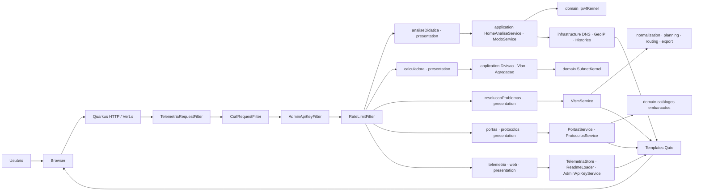

Ordem real dos filtros JAX-RS (prioridade): `TelemetriaRequestFilter` → `CsrfRequestFilter` → `AdminApiKeyFilter` → `RateLimitFilter` → Resource.

Módulos em `presentation`:

| Pacote | Resources principais |
|--------|----------------------|
| `analiseDidatica` | `/`, `/informacoes`, `/api/informacoes/geo`, `/mascara-referencia`, `/history`, `/export/*` |
| `resolucaoProblemas` | `/resolucao-problemas` |
| `portas` / `protocolos` | `/portas`, `/protocolos` |
| `telemetria` | `/telemetria`, `/telemetria/api/*` |
| `web` | `/documentacao`, `/admin/*`, `/icone.png` |

### Fluxo do módulo VLSM/WAN

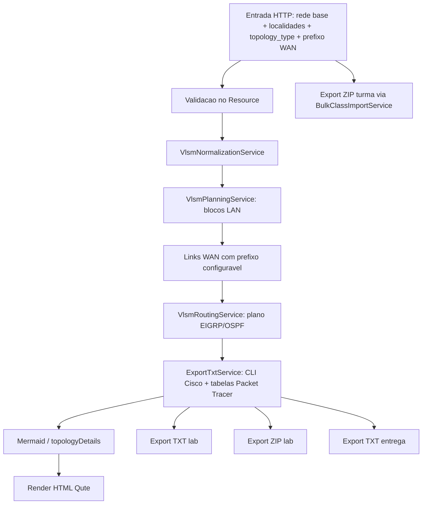

### Fluxo de telemetria (server-side)

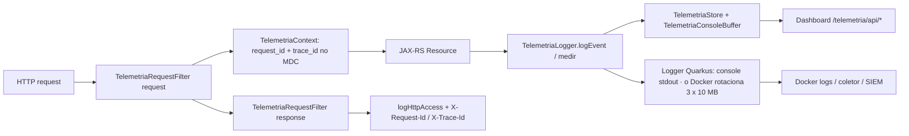

### Utilitários transversais (`shared`)

Entrada do usuário passa por utilitários compartilhados **antes** dos services de domínio, reduzindo risco de injeção, IPs privados/reservados e formatos inválidos.

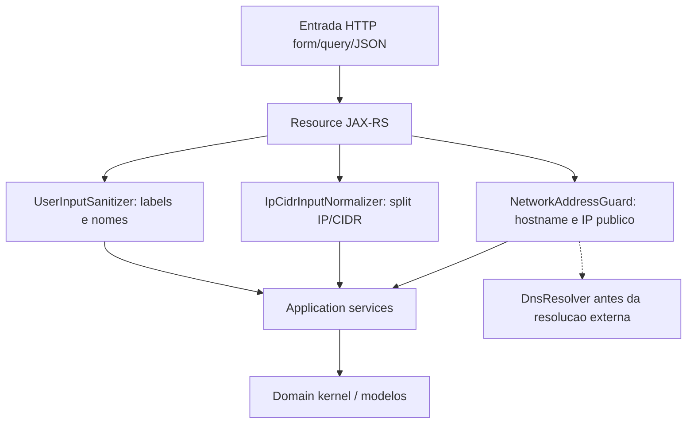

| Classe | Uso principal |
|--------|----------------|
| `UserInputSanitizer` | Nomes de localidade, roster da turma, labels Mermaid |
| `IpCidrInputNormalizer` | Separação e normalização de IP + CIDR na análise e resolução |
| `NetworkAddressGuard` | Bloqueio de hostnames reservados e endereços não públicos no DNS |

### Tratamento de exceções (`ExceptionMapper`)

Cada módulo de domínio possui um `@Provider` JAX-RS que converte exceções tipadas em respostas HTTP seguras e registra o evento na telemetria.

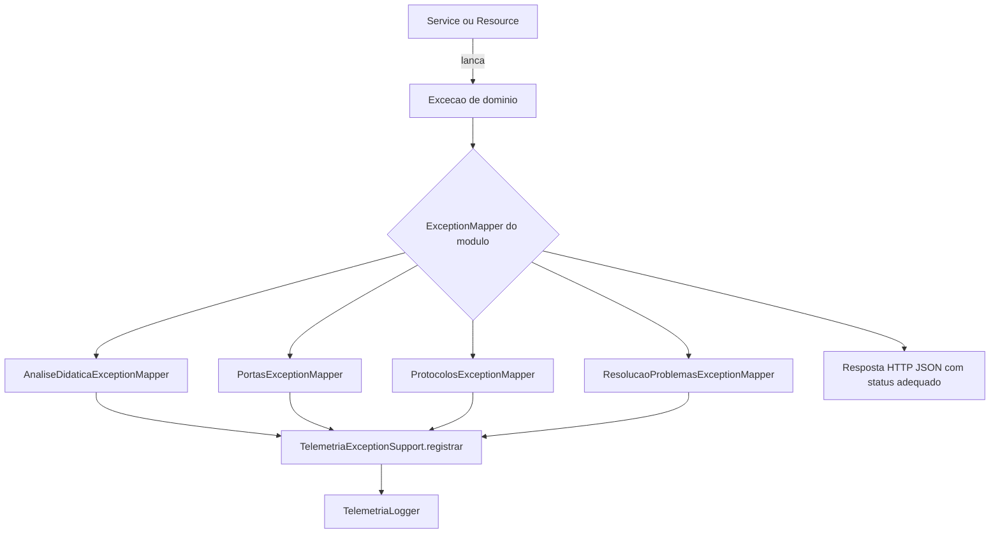

| Mapper | Exceção | Status típico |
|--------|---------|---------------|
| `AnaliseDidaticaExceptionMapper` | `EntradaInvalidaException` | `400` |
| `AnaliseDidaticaExceptionMapper` | `DnsResolucaoException` | `500` |
| `PortasExceptionMapper` | `PortasException` | conforme tipo |
| `ProtocolosExceptionMapper` | `ProtocolosException` | conforme tipo |
| `ResolucaoProblemasExceptionMapper` | `EntradaInvalidaException` / `ResolucaoProblemasException` | `400` / `500` |

> Páginas HTML (Qute) tratam erros de validação inline no Resource (`erro` + `invalidFields` no template), sem passar pelo mapper — os mappers cobrem principalmente respostas JSON e falhas de domínio não capturadas.

### Deploy Docker (build multi-stage → runtime)

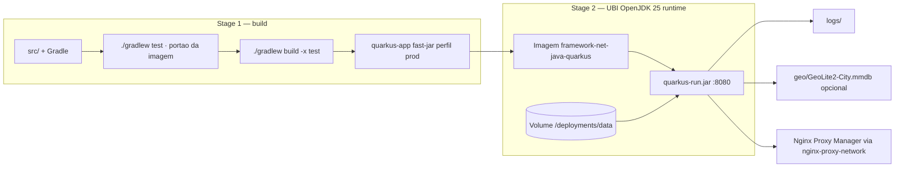

| Etapa | Detalhe |
|-------|---------|
| **Build** | `eclipse-temurin:25-jdk-noble` → `./gradlew test` (a suíte barra a imagem) → `./gradlew build -x test` com `-Dquarkus.package.jar.type=fast-jar -Dquarkus.profile=prod`; o `~/.gradle` fica em cache de montagem do BuildKit entre builds |
| **Runtime** | `registry.access.redhat.com/ubi9/openjdk-25-runtime` — usuário `185`, healthcheck em `/health` |
| **Volume** | `framework-net-data:/deployments/data` — logs, GeoIP e dados da aplicação |
| **Env obrigatórias (prod)** | `ADMIN_API_KEY`, `CSRF_SECRET`, `QUARKUS_PROFILE=prod` |
| **Rede (VPS)** | `nginx-proxy-network` (externa) + bind `127.0.0.1:${HTTP_PORT}:8080` |
| **Dev Docker** | `docker-compose.dev.yml` — dados em `./docker-data`, porta padrão `8081` |

---

### Calculadora de Sub-redes e VLANs — fluxo

Dois pontos de entrada, **um** serviço: a aba em `/analise` e a página `/calculadora`
chamam o mesmo endpoint e recebem o mesmo fragmento Qute renderizado no servidor.

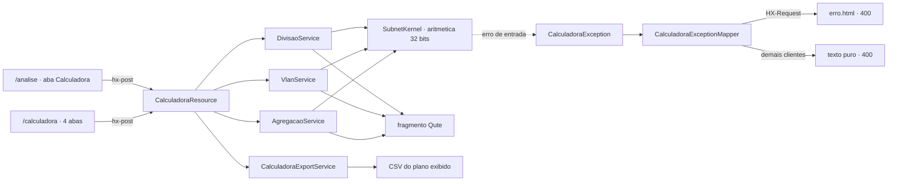

Tetos de renderização (`framework.calculadora.*`) ficam entre o serviço e o
fragmento: o total matemático é sempre calculado, mas a listagem é truncada e o
truncamento é declarado na tela.

### Camadas de proteção da requisição

Cada filtro assume que o anterior falhou. A ordem vem da prioridade JAX-RS de cada um
(`AUTHENTICATION`, `+5`, `+10`, `+20`): a telemetria abre a correlação antes de tudo, a
autenticação vem antes do CSRF, e o rate limit fecha a fila antes de o recurso ser tocado.

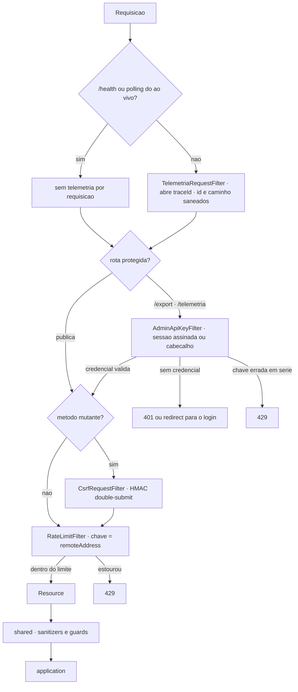

Rota inexistente não passa por esses filtros (nenhum é `@PreMatching`): o `PaginaErroMapper`
aplica o limite a ela, e o `TetoDeEventos` limita os eventos de erro de cliente (4xx) por origem
e minuto, com os suprimidos contados no evento seguinte.

No boot, `SegredosObrigatoriosVerificador` recusa iniciar em produção sem
`ADMIN_API_KEY`/`CSRF_SECRET` — antes, a variável ausente desligava a proteção em
silêncio.

### Cache de APIs externas em dois níveis

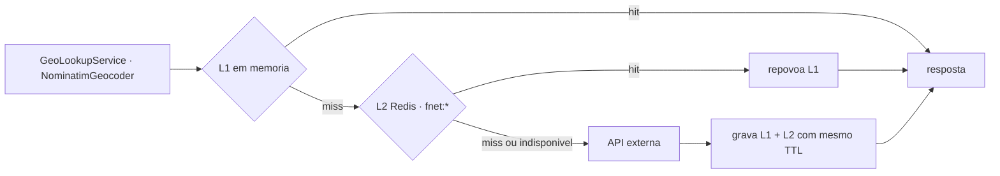

O L2 existe porque o L1 morre a cada deploy e as origens têm limite —
`ip-api.com` corta em 45 req/min. Redis indisponível faz o L2 se comportar como
miss permanente: volta ao comportamento de antes, sem quebrar nada.

---

### Academia: fatias, peers e kernel

A Academia (`org.framework.net.academia`) é um pacote **totalmente desacoplado** do resto do site: cada
nível é uma **fatia vertical** (`fundamentos`, `ipv4`, `transporte`…), a landing e os eventos também; o
**peer** `trilha` é o dono único do catálogo (níveis, lições, rotas, ordem); o **kernel** `core` guarda o
que é técnico e comum. Fatia não importa fatia, e nada da Academia importa módulo de negócio do site — o
`FronteiraAcademiaArchTest` reprova o build com a aresta exata que aparecer (allowlist vazia). A única
saída é a telemetria, por **porta** (`TelemetriaAcademiaPort`), com o adaptador do lado do módulo
transversal `telemetria`.

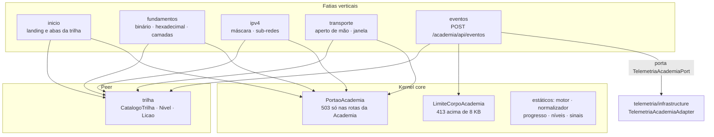

**Uma lição por dentro.** O servidor só entrega HTML anônimo (o catálogo, nunca dado do aluno). As contas
de cada nível rodam no navegador (script próprio da fatia, com gabarito escrito à mão em
`src/test/js/academia` e rodado pelo `AcademiaJsGabaritoTest`); o progresso fica no `localStorage`; o
servidor recebe apenas a visita em faixas.

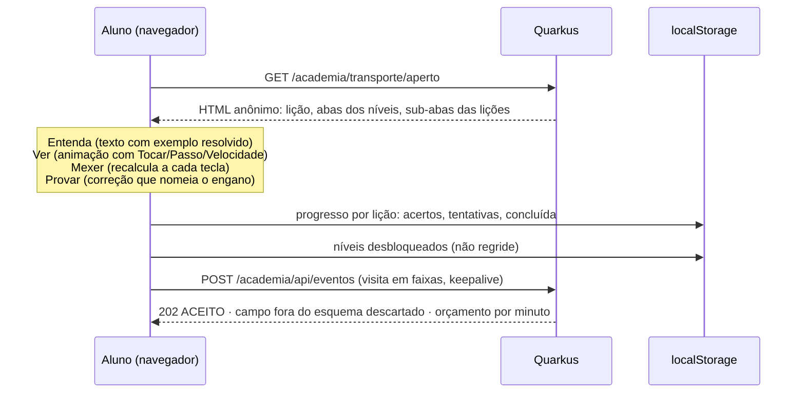

**Desbloqueio dos níveis.** As abas da trilha desbloqueiam um nível por vez, conforme o aluno conclui
todas as lições do anterior (três acertos por lição). O que foi desbloqueado fica registrado e não volta a
trancar — lição nova num nível já concluído não tranca o seguinte; só "apagar o progresso" tranca de novo.
Navegador que não guarda progresso libera tudo e diz isso na tela.

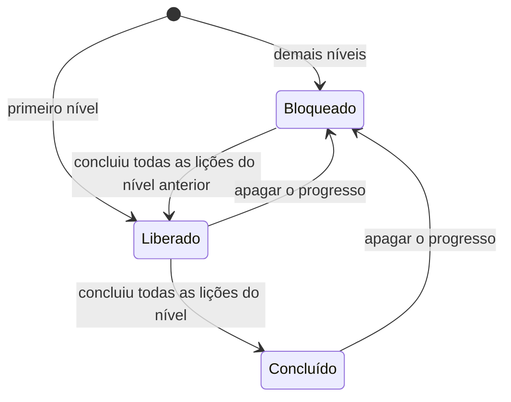

| Guarda | O que impede |
|--------|--------------|
| `FronteiraAcademiaArchTest` | fatia importando fatia, ou a Academia importando módulo de negócio |
| `AcademiaFrontGuardTest` | texto em canvas, endereço externo, HTML cru no JS, valor técnico sem `translate="no"`, campo sem `data-history="off"`, página de fatia carregando asset de outra fatia |
| `AcademiaJsGabaritoTest` | conta da lição divergindo do gabarito escrito à mão (com piso de casos lidos) |
| `AcademiaHttpTest` | página fora do ar, lição sem selo, trilha sem abas, navegação sem caminho de volta |

## ✅ Requisitos

- **JDK 25**
- Gradle (wrapper incluído — `gradlew` / `gradlew.bat`)
- Docker — **obrigatório para o deploy em produção** (a imagem roda a suíte inteira antes de
  montar o artefato); opcional no desenvolvimento, que roda com `quarkusDev`

Dependências principais (`build.gradle`): `quarkus-rest`, `quarkus-rest-jackson`, `quarkus-rest-qute`, `quarkus-qute`, `quarkus-cache`, `quarkus-vertx-http`, `com.github.seancfoley:ipaddress:5.5.1`, `com.maxmind.geoip2:geoip2:4.2.0`.

---

## ▶️ Execução

### Java / Quarkus local

Windows PowerShell:

```powershell
.\gradlew.bat quarkusDev
```

Linux/macOS:

```bash
./gradlew quarkusDev
```

Aplicação em `http://localhost:8080`. Em modo dev, o navegador abre automaticamente quando `%dev.framework.dev.open-browser=true`.

### Docker (VPS)

```bash
docker compose -f docker-compose.yml up -d --build
```

O perfil `prod` (`QUARKUS_PROFILE=prod`) habilita proxy reverso e grava dados persistentes em `/deployments/data`. É **obrigatório** definir `ADMIN_API_KEY` e `CSRF_SECRET` (ver `.env.example` / `docker-compose.yml`).

Parar:

```bash
docker compose -f docker-compose.yml down
```

---

## ⚙️ Variáveis de Configuração

As chaves são definidas em `application.properties` (dev) e `application-prod.properties` (deploy), podendo ser sobrescritas por variáveis de ambiente.

### Aplicação

| Propriedade | Padrão | Descrição |
|-------------|--------|-----------|
| `quarkus.http.port` | `8080` | Porta HTTP |
| `quarkus.http.host` | `0.0.0.0` | Host de bind |
| `framework.app.max-history` | `60` | Tamanho máximo do histórico |
| `framework.calculadora.max-linhas` | `512` | Sub-redes **renderizadas** por divisão. O total real continua sendo calculado e exibido — o teto evita travar o navegador (um `/8` em `/30` são 4.194.304) |
| `framework.calculadora.max-vlans` | `256` | VLANs geradas por plano |
| `framework.calculadora.max-redes-agregacao` | `64` | Redes aceitas por sumarização |
| `framework.app.comparador-cidr-padrao-a` | `20` | CIDR padrão do comparador (A) |
| `framework.app.comparador-cidr-padrao-b` | `24` | CIDR padrão do comparador (B) |
| `framework.dns.cache-ttl-seconds` | `180` | TTL do cache DNS |
| `framework.dns.resolve-timeout-seconds` | `3` | Timeout de resolução DNS |
| `framework.geo.cache-ttl-seconds` | `300` | TTL do cache GeoIP |
| `framework.geo.database-path` | `geo/GeoLite2-City.mmdb` | Base MaxMind (opcional) |
| `framework.dev.open-browser` | `true` (dev) | Abre navegador no `quarkusDev` |
| `framework.site.base-url` | ausente (dev) · `https://frameworknet.carminati.dev.br` (prod) | Host canônico do `/sitemap.xml`. Ausente, a URL segue a requisição. **Não é deduzida do proxy de propósito**: sitemap declara endereço canônico, e cabeçalho de requisição é escolha de quem chama — o Google descarta sitemap de host ou esquema divergente |
| `quarkus.http.proxy.allow-forwarded` | `false` (prod) | **Escolhe a língua do encaminhamento, não liga/desliga proteção.** `true` faz o Vert.x ler só o cabeçalho `Forwarded` (RFC 7239) e **ignorar todos os `X-Forwarded-*`** — que é o que o Nginx do NPM manda. Ficou `true` até 02/09/2026, e o efeito era invisível: URL absoluta saindo em `http://` (o redirect de login) e o rate limit vendo o IP do proxy em todo visitante, isto é, 120 req/min para o site inteiro. **Acoplado ao proxy**: o Vert.x usa a **primeira** entrada do `X-Forwarded-For`, então isto só é seguro enquanto o Nginx mandar `X-Forwarded-For $remote_addr` (substitui) em vez de `$proxy_add_x_forwarded_for` (anexa o valor do cliente). `ProxyEncaminhamentoHttpTest` trava os dois lados que dependem do app |

### Telemetria

| Propriedade | Padrão | Descrição |
|-------------|--------|-----------|
| `framework.logs.base-dir` | `logs` | Pasta de logs/exportações |
| `framework.telemetry.enabled` | `true` | Habilita coleta |
| `framework.telemetry.dashboard-enabled` | `true` | Habilita a página `/telemetria` |
| `framework.telemetry.max-events` | `5000` | Eventos em buffer |
| `framework.telemetry.jsonl-max-bytes` | `10485760` | Limite do JSONL ativo antes de manter uma única geração anterior |

### Segurança

| Propriedade | Padrão (dev) | Descrição |
|-------------|--------------|-----------|
| `framework.security.csrf-enabled` | `true` | Proteção CSRF |
| `framework.security.csrf-secret` | *(dev)* | Segredo do token CSRF — **trocar em prod** (`CSRF_SECRET`) |
| `framework.security.sensitive-apis-enabled` | `true` | Habilita APIs sensíveis |
| `framework.security.rate-limit-enabled` | `true` | Habilita rate limiting |
| `framework.security.rate-limit-per-minute` | `120` | Limite geral por minuto |
| `framework.security.rate-limit-heavy-per-minute` | `30` | Limite de rotas pesadas |
| `framework.security.admin-api-key` | *(dev)* | Chave admin — em prod via `ADMIN_API_KEY` |
| `framework.security.admin-api-key-required` | `true` | Exige chave nas rotas protegidas |

### Variáveis de ambiente (deploy Docker)

- `HTTP_PORT` (padrão `8080`) — porta publicada no host;
- `ADMIN_API_KEY` — **obrigatória** em prod; gere uma vez e mantenha no `.env` da VPS;
- `CSRF_SECRET` — **obrigatória** em prod; gere uma vez e mantenha no `.env` da VPS;
- `GEO_DB_HOST_PATH` — caminho do `GeoLite2-City.mmdb` no host (opcional);
- `QUARKUS_PROFILE=prod`.

Comandos seguros de deploy na VPS:

```bash
cd /opt/framework-net-java-quarkus
git pull origin main
test -f .env || cp .env.example .env
docker compose up -d --build
docker compose ps
docker compose logs --tail=20 -f
```

Deploy automatizado:

```bash
cd /opt/framework-net-java-quarkus
chmod +x scripts/deploy.sh
scripts/deploy.sh
```

---

## 🔐 Segurança

- **Chave administrativa** — rotas sob o prefixo `/export` são protegidas. O acesso é liberado por:
  - header `X-Admin-Api-Key: <chave>`, **ou**
  - cookie `ADMIN_API_KEY` obtido via login em `/admin/login`.
  - A exigência só é ativada quando `admin-api-key-required=true` **e** a chave está configurada; a comparação usa tempo constante.
- **CSRF** — filtros de request/response emitem e validam token para operações sensíveis.
- **Rate limiting** — limites por minuto configuráveis (geral e rotas pesadas).
- **Headers HTTP de segurança** — `X-Content-Type-Options: nosniff`, `X-Frame-Options: SAMEORIGIN`, `Referrer-Policy: strict-origin-when-cross-origin`, `Permissions-Policy` restritiva.
- **Sanitização de entrada** — `UserInputSanitizer`, `IpCidrInputNormalizer` e `NetworkAddressGuard` no pacote `shared`.
- **`robots.txt`** (`META-INF/resources/robots.txt`) — política pública para robôs: buscador
  legítimo indexa as páginas didáticas; coletor de treinamento de modelo e robô de SEO ficam
  de fora; nenhum robô entra em `/admin`, `/login`, `/telemetria`, `/history`, `/export`,
  `/informacoes`, `/health`, `/mascara-referencia` nem nas rotas de API. A linha
  `Sitemap:` aponta para o `/sitemap.xml`, que lista exatamente as páginas que os grupos
  permissivos deixam abertas — o `SitemapHttpTest` reprova o build se os dois se
  contradisserem.
  **Não é controle de acesso** — o arquivo é público e só vale para o robô que escolhe
  obedecer; quem fecha as rotas é o login pelo GitHub e o `AdminApiKeyFilter`. O que ele
  evita é custo e ruído: `/informacoes` dispara consulta geográfica externa a cada GET
  (ip-api, 45 req/min), `/export` gera PDF sob demanda e `/history` só tem sentido para
  o navegador que fez as consultas (o histórico é separado por sessão, via cookie `fnet_hist`
  HttpOnly com identificador aleatório; o arquivo guarda só o hash dele). Em produção, veja a nota do próprio arquivo: o nginx do proxy reverso serve um
  `/robots.txt` compartilhado por match exato e a resposta não chega à aplicação.

---

## 📋 Telemetria e Observabilidade (Server-Side)

A telemetria é orientada a servidor e possui dashboard próprio em `/telemetria`.

Implementado:

- `request_id` e `trace_id` por requisição (via `TelemetriaRequestFilter` + MDC);
- eventos estruturados (`TelemetriaLogger.logEvent` / `logException`);
- buffer em memória + arquivo compartilhado (`TelemetriaStore`);
- console ao vivo e exportação JSON (`/telemetria/api/exportar`);
- logs no console (stdout), com rotação feita pelo Docker (`logging` do `docker-compose.yml`: 3 arquivos de 10 MB); o log em arquivo do Quarkus fica desligado de propósito;
- a sonda `/health` do container **não** é registrada — antes o healthcheck consultava
  `/` a cada 30 s (~2.880 acessos/dia) e era indistinguível de visitas reais.

### Correlação dos eventos de negócio

Serviços de aplicação chamam `TelemetriaLogger.medir()` sem ter o
`ContainerRequestContext` do JAX-RS em mãos. A correlação é então **resgatada do MDC**
da própria thread da requisição (`TelemetriaContext.contextoDoMdc()`), de modo que todo
evento nascido dentro de um request carrega `traceId` e `requestId`.

Isso importa porque um único incidente rende mais de um evento — a operação de negócio
que falhou, a exceção mapeada e o acesso HTTP. **Agrupe por `traceId`** para contar
incidentes em vez de linhas. Eventos nascidos fora de requisição (`app_start`, tarefas
de fundo) seguem sem correlação, e isso é o valor honesto: correlação fabricada seria
pior que correlação ausente.

### Formato de compartilhamento: OpenTelemetry OTLP/JSON

Os artefatos compartilháveis seguem o **[OpenTelemetry Logs Data Model](https://opentelemetry.io/docs/specs/otel/logs/data-model/)** serializado em **OTLP/JSON** — o padrão da indústria para interoperar telemetria com Grafana, Loki, Jaeger, Datadog, SIEMs, etc.

| Artefato | Formato | Descrição |
|----------|---------|-----------|
| `logs/telemetria_compartilhada.json` | OTLP `LogsData` | Documento canônico (`resourceLogs → scopeLogs → logRecords`) |
| `logs/framework-net-eventos.jsonl` | NDJSON de `LogRecord` OTLP | Stream append (um `LogRecord` por linha) |
| `GET /telemetria/api/exportar` | OTLP `LogsData` | Download do documento canônico |

Mapeamento (`TelemetriaOtlpMapper`): `timeUnixNano`/`intValue` como *string* (int64 conforme OTLP/JSON), `severityNumber`/`severityText` (INFO=9, WARN=13, ERROR=17), `traceId`/`spanId` em hexadecimal, e atributos com convenções semânticas (`service.name`, `http.request.method`, `http.route`, `http.response.status_code`, `event.name`) + atributos próprios em `framework.*`.

> As APIs internas do dashboard (`/telemetria/api/resumo` e `/telemetria/api/dashboard`) permanecem no schema próprio de UI — o OTLP é usado nos artefatos de **exportação/compartilhamento**.

Coleta recomendada em produção: `docker logs` / `compose logs` e agregador central (ELK, Loki, Datadog, Splunk, SIEM) — o OTLP/JSON pode ser reenviado a um OpenTelemetry Collector.

### Dataset público (sanitização)

A telemetria é artefato temporário destinado a virar **dataset público**. O caminho vivo é o
botão **Sincronizar dataset** em `/telemetria` (só o dono): o `DatasetPublicavelService` gera o
pacote em memória, a auditoria final roda sobre o arquivo pronto e só então o
`GitHubDatasetPublisher` grava o snapshot do dia no repositório público.

| Dado | Tratamento |
|------|------------|
| IP, host ou endereço consultado | `id-NNN`, sequencial **dentro do pacote** — sem sal, sem segredo; não correlaciona entre snapshots |
| Campos de evento | **esquema fechado** (`CAMPOS_PUBLICAVEIS`): só contagens, booleanos e vocabulário fixo. Mensagem de exceção, hostname, domínio, regra de ACL e rede digitada ficam de fora; campo novo é contado por nome em `estatisticas.json` (`campos_fora_do_esquema`) |
| Rota (`http.route` e o campo `rota`) | segmento que não é palavra fixa vira `{param}` |
| `lat` / `lon` / GPS | **Removidos** |
| `body` (texto livre) | **Reconstruído** a partir dos atributos já sanitizados, nunca filtrado por regex |
| `traceId` | Preservado — aleatório por requisição, é o que torna o dataset analisável |
| Estáticos, `/q/*`, `/web/*`, `/telemetria/api*`, `/health`, polling do ao vivo | Descartados como ruído de infraestrutura |

A **auditoria final** varre o arquivo gerado (IP público, coordenada, e-mail residual): se achar,
a geração falha com 422 e nada é publicado. Publicar não tem desfazer.

`scripts/exportar-dataset.sh` + `scripts/sanitizar_telemetria.py` são o **caminho antigo**
(pseudônimo por hash com sal fixo no `.env`). O script **aborta de propósito** quando o sal não
existe — gerar um sal novo produziria pseudônimos incompatíveis com o snapshot de 2026-08-04 já
publicado. Só serve para quem precisa do JSONL inteiro (o botão recorta a janela lida) e assume
conscientemente a divergência entre os dois modelos.

---

## 🗂️ Estrutura de Pastas

```text
framework-net-java-quarkus/
├── build.gradle · settings.gradle · gradle.properties · gradlew(.bat)
├── Dockerfile · docker-compose.yml · docker-compose.dev.yml · .env.example
├── logs/
├── src/main/java/org/framework/net/
│   ├── academia/            # escola de redes: core (kernel), trilha, inicio, fundamentos, ipv4, transporte, eventos
│   ├── analiseDidatica/     # application, config, domain/kernel, infrastructure (dns/geo/historico), presentation, support
│   ├── analiseTrafego/      # decodificador de pacotes, construtor, laboratório DNS/ICMP, ao vivo (aovivo/)
│   ├── calculadora/         # application, config, domain, exception, presentation
│   ├── camadas/             # aprofundamento OSI × TCP/IP
│   ├── certificados/        # aprofundamentos X.509/PKI
│   ├── criptografia/        # aprofundamentos e playground de hash
│   ├── ferramentas/         # catálogo de CLI e construtor de comando
│   ├── ferramentasDiagnostico/ # diagnóstico simulado (ping, traceroute, dig, varreduras)
│   ├── health/              # /health do container (fora da telemetria)
│   ├── ipv6/                # análise, divisão, projeto e engenharia reversa IPv6
│   ├── laboratorios/        # laboratórios guiados
│   ├── localizacao/         # GeoIP, CEP (ViaCEP), geocodificação (Nominatim), mapa
│   ├── paginaErros/         # página de erro única para os 18 códigos
│   ├── portas/              # catálogo e aprofundamentos de portas
│   ├── protocolos/          # catálogo e aprofundamentos (BGP, SSH, DNS, TLS…)
│   ├── resolucaoProblemas/  # application (export/importing/normalization/planning/routing), domain (kernel/model), presentation
│   ├── security/            # chave admin, sessão assinada, CSRF, rate limit, APIs sensíveis
│   ├── segurancaRede/       # ACL, firewall com/sem estado, TLS, alcançabilidade de fluxo
│   ├── shared/              # kernel: sanitizers, guards, IpLiteral, cache (L1/L2), disjuntor, fuso do site
│   ├── simuladores/         # handshake, encapsulamento, anomalias TCP
│   ├── telemetria/          # store, Stream, dashboard, dataset, filtro, teto de eventos
│   ├── web/                 # home, documentação, login admin, SEO, menu, filtros de resposta
│   └── wifi/                # aprofundamentos 802.11 e planejador de canais
├── src/main/resources/
│   ├── application.properties · application-prod.properties
│   ├── README.md            # esta documentação (renderizada em /documentacao)
│   ├── templates/           # Qute: home, analiseDidatica, portas, protocolos, resolucaoProblemas, telemetria, admin, documentacao, shared
│   └── META-INF/resources/  # estáticos: CSS por módulo (home/, portas/, protocolos/, telemetria/, resolucaoProblemas/, documentacao/) + web/ (design system compartilhado) + JS + ícone
└── src/test/java/org/framework/net/   # JUnit 5 + RestAssured
```

---

## 🧪 Testes

Suíte em **JUnit 5** + **RestAssured** (`quarkus-junit`, `rest-assured`), em `src/test/java`.

```powershell
.\gradlew.bat test
```

Cobertura por área:

| Área | Exemplos de testes |
|------|--------------------|
| Análise Didática | `Ipv4KernelTest`, `AnaliseDidaticaHttpTest`, `AnaliseExportHttpTest`, `HistoricoApiHttpTest`, `GeoLookupServiceTest`, `PdfSimplesServiceTest` |
| Calculadora | `DivisaoServiceTest`, `VlanServiceTest`, `AgregacaoServiceTest`, `CalculadoraHttpTest` |
| IPv6 | `Ipv6SubnetKernelTest` (kernel: análise, EUI-64, ULA, sumarização, faixa, projeto, engenharia reversa, nibbles, VLANs, solicited-node), `Ipv6HttpTest` (as abas e APIs), `Ipv6DominioAaaaIT` (resolução AAAA, guardada por `Assumptions`) |
| Saúde | `HealthResourceTest` |
| Portas / Protocolos | `PortasServiceTest`, `ProtocolosServiceTest` |
| Resolução VLSM/WAN | `VlsmServiceTest`, `VlsmPlanningServiceTest`, `ResolucaoProblemasHttpTest`, `BulkClassImportServiceTest` |
| Segurança | `AdminApiKeyServiceTest`, `AdminApiKeyHttpTest`, `CsrfTokenServiceTest` |
| Telemetria | `TelemetriaLoggerTest`, `TelemetriaHttpTest`, `TelemetriaConsoleBufferTest`, `TelemetryDisabledHttpTest`, `TelemetriaStoreRotationTest`, `ModuloDePathTest`, `CorrelacaoEventosTest` |
| Menu e rotas | `MenuRotasHttpTest` |
| Arquitetura | `ArquiteturaCamadasTest` |
| Shared / Web | `UserInputSanitizerTest`, `IpCidrInputNormalizerTest`, `NetworkAddressGuardTest`, `WebIntegrationTest`, `DevBrowserLauncherTest` |

### Testes que guardam regras, não só comportamento

Seis suítes existem para impedir classes inteiras de regressão, e não para verificar
um caso de uso:

- **`ArquiteturaCamadasTest`** — lê os imports dos fontes e reprova o build se
  `domain` passar a conhecer HTTP/Qute/camadas externas, se `application` importar
  `presentation`, se dois módulos de negócio se acoplarem sem registro explícito, ou
  se um `@Path` aparecer fora de `presentation`.
- **`MenuRotasHttpTest`** — abre as 22 rotas do menu, confere que o link de cada uma
  se marca como ativo (e que outro link não) e navega para as demais. Conta os itens no HTML renderizado: **item novo
  no menu sem teste correspondente quebra o build**.
- **`ModuloDePathTest`** — trava a tabela que atribui cada rota a um módulo no
  dashboard. Existe porque o `default` do switch apontava para "Análise Didática", e
  com isso `/calculadora`, `/sobre`, `/admin` e `/simuladores` eram silenciosamente
  contabilizados no módulo errado — bug que não gera exceção, só número errado.
- **`RobotsTxtHttpTest`** — lê o `robots.txt` como um robô lê (grupos, casamento por
  prefixo) e reprova o build quando um grupo permissivo esquece uma rota fechada, quando
  uma rota de API **declarada por `@Path` no código** não está bloqueada, ou quando uma
  página didática é bloqueada por engano. Existe porque o robots.txt **não soma grupos**:
  o robô obedece só ao bloco mais específico que casa com o nome dele, e o que faltar ali
  fica liberado em silêncio. A varredura dos fontes falha fechada — nenhuma rota
  encontrada reprova, em vez de aprovar por cegueira.
- **`ProxyEncaminhamentoHttpTest`** — reproduz a configuração de proxy do perfil `prod` e
  prova que a aplicação **ouve** o que o Nginx conta: `X-Forwarded-Proto` decide o esquema
  das URLs absolutas, e `X-Forwarded-For` decide a chave do rate limit (clientes distintos
  não compartilham balde, e o mesmo cliente continua limitado — este último é o caso-controle,
  sem ele um rate limit desligado aprovaria o teste anterior por engano). Existe porque a
  falha é **invisível**: com `allow-forwarded` ligado junto de `proxy-address-forwarding`, o
  site responde 200 igual, só que em `http://` e com um balde só para todo mundo.
- **`SitemapHttpTest`** — cruza três artefatos: o menu, o `robots.txt` e o `sitemap.xml`.
  Reprova quando uma página do menu aberta aos robôs fica de fora do sitemap, quando o
  sitemap oferece o que o robots fecha (contradição que o buscador resolve **contra** o
  site) e quando uma URL listada não responde 200. O `SitemapBaseUrlHttpTest` cobre o
  outro lado: com host canônico configurado, nenhuma entrada pode sair em `http://` nem
  vazar `localhost`.

### Ao criar um módulo novo, atualize também

1. `shared/main_menu.html` **e** `MenuRotasHttpTest` (a contagem de itens é verificada);
2. `RateLimitFilter.HEAVY_PATHS` — e o `startsWith` do subcaminho, se as APIs forem pesadas;
3. `TelemetriaDashboardService.moduloDePath` — senão o tráfego é creditado a outro módulo;
4. `templates/home/index.html` — o bloco do módulo na landing;
5. `META-INF/resources/robots.txt` — o prefixo da API nova, **em todos** os grupos
   permissivos (o `RobotsTxtHttpTest` cobra, mas só depois de o build quebrar);
6. `web/domain/PaginasPublicas` — se o módulo tem página no menu: é a fonte única lida
   pelo sitemap, pelo canonical e pelas guardas (o `SitemapHttpTest` cobra do mesmo jeito);
7. este README.

---

## 🛣️ Roadmap

- [x] Migração de Python/Flask para Java 25 + Quarkus 3.37
- [x] VLSM dinâmico para N localidades
- [x] Topologias WAN estrela / estrela estendida / malha / anel / anel redundante
- [x] EIGRP + OSPF (distribuição por site, AS/processo opcionais)
- [x] Telnet explícito nos scripts (`transport input telnet`)
- [x] Demos (`?demo=gs|fiap|8|1`) e exportações lab/entrega/turma
- [x] Prefixo WAN configurável e CIDR da base opcional com inferência
- [x] Catálogos de portas e protocolos
- [x] Módulo de telemetria com dashboard e console ao vivo
- [x] Segurança: chave admin, CSRF, rate limiting e headers HTTP
- [x] GeoIP MaxMind (opcional) e resolução DNS com cache
- [ ] Persistência externa de logs operacionais (stack de observabilidade)
- [ ] Filtros avançados de histórico por período e modo

---

## 👨‍💻 Autor

Paulo André Carminati — site pessoal: [carminati.dev.br](https://carminati.dev.br/)

---

## 📄 Licença

MIT.
